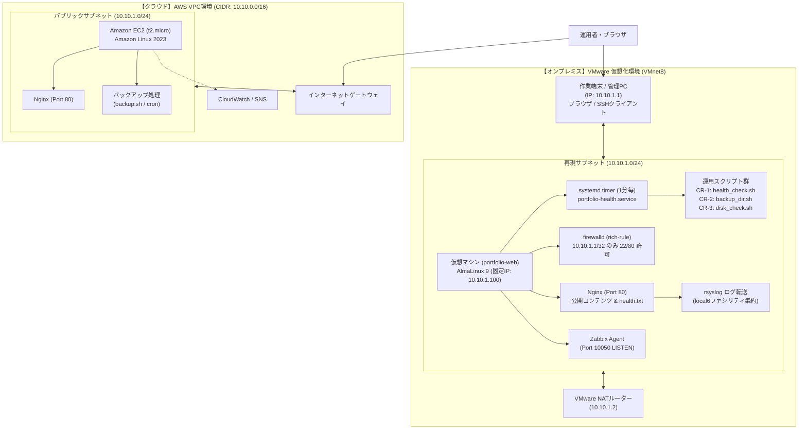
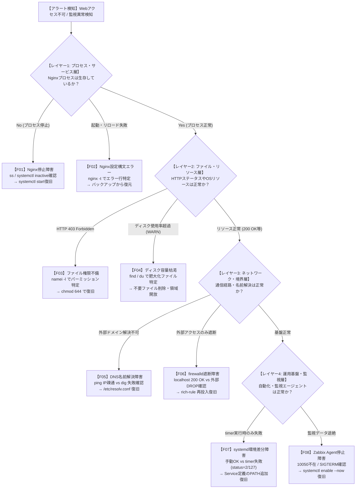

# 🚀 Webインフラ構築・運用保守 総合ポートフォリオ
## 〜 AWSクラウド ＆ オンプレミス（仮想化）ハイブリッド検証・障害対応レポート 〜

本ドキュメントは、**AWS（Amazon Web Services）**上での設計・構築・運用保守自動化の実績、およびそれらをローカル（オンプレミス）の仮想化環境（**VMware Workstation / AlmaLinux 9**）上で高精度に再現・比較検証したハイブリッドインフラ構築プロジェクトの全容を1つに統合した成果物レポートです。

単なる「構築手順の記録」にとどまらず、実務のインフラ運用現場で求められる**「詳細パラメータ設計」「定期ヘルスチェックの自動化（systemd timer）」「監視基盤（Zabbix / rsyslog）」「既存運用スクリプトの改修・バリデーション強化（CR-1〜CR-3）」「8大障害シナリオに対する論理的一次切り分けと復旧実証（F01〜F08）」**までを体系的に網羅しています。

---

## 📋 目次

- [1. 全体概要とプロジェクト目的](#1-全体概要とプロジェクト目的)
  - [1.1 プロジェクト概要](#11-プロジェクト概要)
  - [1.2 インフラ全体構成図（ハイブリッド構成）](#12-インフラ全体構成図ハイブリッド構成)
  - [1.3 クラウドとオンプレミスの機能対比表](#13-クラウドとオンプレミスの機能対比表)
  - [1.4 AWSクラウド環境の主要設計値](#14-awsクラウド環境の主要設計値)
  - [1.5 オンプレミス（仮想化）環境での検証目的](#15-オンプレミス仮想化環境での検証目的)
- [2. AWSクラウド環境の設計・構築](#2-awsクラウド環境の設計構築)
  - [2.1 ネットワーク環境の新規構築（VPC / Subnet / IGW）](#21-ネットワーク環境の新規構築vpc--subnet--igw)
  - [2.2 Webサーバーの土台構築とセキュリティ設定（EC2 / IAMロール / SG）](#22-webサーバーの土台構築とセキュリティ設定ec2--iamロール--sg)
  - [2.3 SSH接続とWebサーバー（Nginx）の導入・疎通確認](#23-ssh接続とwebサーバーnginxの導入疎通確認)
  - [2.4 ネットワーク疎通・システムリソースの稼働状態確認](#24-ネットワーク疎通システムリソースの稼働状態確認)
  - [2.5 運用保守の自動化（シェルスクリプトによる定時バックアップ実装）](#25-運用保守の自動化シェルスクリプトによる定時バックアップ実装)
  - [2.6 Amazon CloudWatchによるリソース監視・アラーム通知設定](#26-amazon-cloudwatchによるリソース監視アラーム通知設定)
- [3. オンプレミス（VMware / AlmaLinux 9）環境の設計・構築・動作検証](#3-オンプレミスvmware--almalinux-9環境の設計構築動作検証)
  - [3.1 ネットワークおよび詳細パラメータ設計](#31-ネットワークおよび詳細パラメータ設計)
  - [3.2 Webサーバー構築とアクセス制御（Nginx / firewalld rich-rule）](#32-webサーバー構築とアクセス制御nginx--firewalld-rich-rule)
  - [3.3 運用保守・定期自動監視基盤（systemd service / timer）](#33-運用保守定期自動監視基盤systemd-service--timer)
  - [3.4 監視エージェントおよびログ集約基盤（Zabbix Agent / rsyslog）](#34-監視エージェントおよびログ集約基盤zabbix-agent--rsyslog)
  - [3.5 基本・統合動作試験結果（T01〜T19）](#35-基本統合動作試験結果t01t19)
- [4. 運用ツールの改修実績（Change Request: CR-1 〜 CR-3）](#4-運用ツールの改修実績change-request-cr-1--cr-3)
  - [4.1 変更管理（CR）の運用方針](#41-変更管理crの運用方針)
  - [4.2 CR-1: health_check.sh（タイムアウト・応答本文検証・終了コード厳密化）](#42-cr-1-health_checkshタイムアウト応答本文検証終了コード厳密化)
  - [4.3 CR-2: backup_dir.sh（引数化・事前バリデーション・復元後diff差分照合）](#43-cr-2-backup_dirsh引数化事前バリデーション復元後diff差分照合)
  - [4.4 CR-3: disk_check.sh（設定ファイル分離・引数上書き・入力バリデーション）](#44-cr-3-disk_checksh設定ファイル分離引数上書き入力バリデーション)
- [5. 障害対応手順書（Runbook）：実務レベルの一次切り分け・復旧実証（F01 〜 F08）](#5-障害対応手順書runbook実務レベルの一次切り分け復旧実証f01--f08)
  - [5.1 障害対応アプローチと階層型切り分けフロー](#51-障害対応アプローチと階層型切り分けフロー)
  - [5.2 【F01】Nginxプロセス停止障害（Connection refused検知）](#52-f01nginxプロセス停止障害connection-refused検知)
  - [5.3 【F02】Nginx設定構文エラー（reload失敗）](#53-f02nginx設定構文エラーreload失敗)
  - [5.4 【F03】公開ファイル権限不備（HTTP 403 Forbidden）](#54-f03公開ファイル権限不備http-403-forbidden)
  - [5.5 【F04】ディスク容量枯渇障害（WARN検知・大容量ファイル特定）](#55-f04ディスク容量枯渇障害warn検知大容量ファイル特定)
  - [5.6 【F05】外部名前解決（DNS）障害（IP直打ち疎通 vs ドメイン解決不可）](#56-f05外部名前解決dns障害ip直打ち疎通-vs-ドメイン解決不可)
  - [5.7 【F06】firewalldによる外部通信遮断（localhost疎通 vs 外部タイムアウト）](#57-f06firewalldによる外部通信遮断localhost疎通-vs-外部タイムアウト)
  - [5.8 【F07】systemd timer 実行環境差異（非対話実行時のPATH欠落）](#58-f07systemd-timer-実行環境差異非対話実行時のpath欠落)
  - [5.9 【F08】監視エージェント（Zabbix Agent）プロセス停止検知](#59-f08監視エージェントzabbix-agentプロセス停止検知)
- [6. 総括とハイブリッド環境における習得スキル](#6-総括とハイブリッド環境における習得スキル)
  - [6.1 本プロジェクトの成果と設計意図](#61-本プロジェクトの成果と設計意図)
  - [6.2 証明される習得スキル](#62-証明される習得スキル)
  - [6.3 今後の展望](#63-今後の展望)

---

# 1. 全体概要とプロジェクト目的

## 1.1 プロジェクト概要
本プロジェクトでは、AWS上における仮想ネットワーク環境（VPC）の設計・構築から、EC2インスタンスによるWebサーバー（Nginx）の起動、保守自動化（バックアップスクリプト・cron定時実行）、およびAmazon CloudWatchによるシステム監視設定までを網羅した「AWSクラウドインフラ環境」を構築しました。

さらに、クラウド環境での設計思想をローカル（オンプレミス）の仮想化環境（VMware / AlmaLinux 9）上でシミュレーションし、クラウドとオンプレミスのハイブリッド環境におけるインフラ構築・運用の比較検証を実施しました。

特にオンプレミス環境においては、以下の実務運用フェーズの全ライフサイクルを深く追究しています：
* **「詳細パラメータ設計」**: なぜその設定値にするのかの根拠（設計理由）と確認結果の管理。
* **「通信・疎通確認」**: レイヤーごとの内部・外部からの通信疎通検証。
* **「運用の自動化・改修」**: 単にスクリプトを動かすだけでなく、異常系の例外処理やバリデーション、systemd timerによる定期監視、変更管理手順（Change Request）に則った改修。
* **「常時監視・ログ集約」**: Zabbix Agentによるメトリクス収集とrsyslogによる集中ログ転送。
* **「障害時の一次切り分け」**: 頻発する8つのシステム障害に対する論理的な仮説検証・復旧実証（ランブック化）。

## 1.2 インフラ全体構成図（ハイブリッド構成）

本プロジェクトで構築・検証したインフラの全体構成図です。AWS上のVPC環境と、VMware上の仮想化環境における設計的・技術的な対応関係を示しています。



## 1.3 クラウドとオンプレミスの機能対比表

AWSクラウド上の各インフラ構成要素と、オンプレミス（VMware）環境における技術的対応関係の一覧です。両環境の設計思想と差異を体系的に比較しています。

| 比較項目 | AWSクラウド環境 | オンプレミス（VMware）環境 | 技術的ポイント・設計意図 |
| :--- | :--- | :--- | :--- |
| **仮想化ホスト** | AWSマネージドインフラ | VMware Workstation (ローカル) | クラウドプロバイダ管理とローカルハイパーバイザの違い |
| **ゲストOS** | Amazon Linux 2023 | AlmaLinux 9.x | RedHat系・dnfパッケージ管理の親和性を担保 |
| **ホスト名** | EC2プライベートDNS名 | `portfolio-web` | 複数サーバー運用時の誤操作防止・ログ識別 |
| **仮想ネットワーク** | VPC (Subnet: `10.10.1.0/24`) | VMware NATモード (Subnet: `10.10.1.0/24`) | クラウドVPCのIP設計をオンプレミス環境で忠実に再現 |
| **外部通信経路** | インターネットゲートウェイ (IGW) | 仮想NATルーター (`10.10.1.2`) | 外部インターネット接続およびデフォルトゲートウェイルーティング |
| **ファイアウォール** | セキュリティグループ (SG) | `firewalld` (rich-rule設定) | クラウドの境界型防御とホストOS内部の送信元IP限定制御（`10.10.1.1/32`） |
| **リモート管理** | SSM Session Manager / SSH | SSH接続 (ポート22: 送信元IP制限) | root直接ログイン禁止、一般ユーザー（`labuser`等）による権限分離 |
| **Webサーバー** | Nginx (HTTP Port 80) | Nginx (HTTP Port 80) | 同一ミドルウェアを用いた設定プロセスの検証およびヘルスチェック配置 |
| **タスク自動実行** | `cron` 定時実行 | `systemd.timer` (`OnUnitActiveSec=1min`) | cronとsystemdタイマーのログ管理性（journald連携）や環境差異の比較 |
| **運用保守ツール** | 日付付き `tar` バックアップスクリプト | 改修版スクリプト群（CR-1〜CR-3） | 引数チェック、書き込み権限検証、外部設定ファイル分離、インジェクション対策 |
| **死活・リソース監視** | Amazon CloudWatch / SNS | Zabbix Agent (Port 10050) & スクリプト | クラウド統合監視とオンプレミス標準OSS監視エージェントの対比 |
| **ログ管理** | CloudWatch Logs (CWAgent) | `rsyslog` 転送 (local6ファシリティ) | OS標準syslog機構を用いたリアルタイムログ隔離・転送 |

## 1.4 AWSクラウド環境の主要設計値

| 項目 | 採用テクノロジー / 設計値 | 目的・特徴 |
| :--- | :--- | :--- |
| **仮想ネットワーク** | VPC (`10.10.0.0/16`) / パブリックサブネット (`10.10.1.0/24`) | セキュアで論理的に分離されたNW空間の確保 |
| **仮想サーバー** | Amazon EC2 (Amazon Linux 2023, t2.micro) | 動的なWebサイトをホストする中核インフラ |
| **Webサーバー** | Nginx (HTTP Port 80) | 高パフォーマンスで軽量なリバースプロキシ・Webサーバー |
| **アクセス管理** | SSH (Port 22: 送信元IP制限) & SSM Session Manager | 最小権限の原則に基づく安全なリモート管理 |
| **保守自動化** | Shell Script (`tar` バックアップ) & `cron` 定時実行 | 人的ミスを防ぐシステムバックアップ自動化 |
| **リソース監視** | Amazon CloudWatch Alarm & Amazon SNS (Email) | CPU過負荷検知および異常時の即時メール通知 |

## 1.5 オンプレミス（仮想化）環境での検証目的
AWS環境の専用OS「Amazon Linux 2023」の再現として、パッケージ構成やベースシステムが極めて近い「AlmaLinux 9」を採用。AWS側のVPC設計（`10.10.1.0/24`）をローカル側で完全にシミュレートし、固定IPアドレスの割り当て、ホストPCからの安全なSSHリモート接続、およびOS内ファイアウォールを制御したWebサーバー（Nginx）の導入までを実証しました。

さらに今回のアップデートにより、単なる構築にとどまらず、**パラメータシートに基づく構成管理、systemd timerによる自律運用、OSS監視基盤の構築、運用ツールの設計改修（Change Request）、そして8種類の障害に対する論理的な一次切り分け**を実践・記録することで、現場で自走できるインフラエンジニアとしての実務適性を証明しています。

---

# 2. AWSクラウド環境の設計・構築

## 2.1 ネットワーク環境の新規構築（VPC / Subnet / IGW）
システム基盤となるパブリックサブネット含むVPC環境をAWS上に構築しました。

* **設計値**：VPC: `my-network-vpc01` (`10.10.0.0/16`) / サブネット: `my-public-subnet01` (`10.10.1.0/24`)

#### ① VPC（仮想ネットワーク空間）の作成
将来の拡張性を考慮し、IPアドレス範囲 `10.10.0.0/16` にてVPCを新規作成。


#### ② パブリックサブネットの作成
仮想サーバーを配置するため、VPC内にCIDR範囲 `10.10.1.0/24` のパブリックサブネットを切り出し。


#### ③ インターネットゲートウェイ（IGW）の接続
VPC内部から外部インターネットと双方向通信を行うためのIGWを作成し、VPCにアタッチ。


#### ④ ルートテーブルの構成とサブネットの関連付け
ルートテーブルを新規作成し、デフォルトルート（`0.0.0.0/0`）の送信先としてIGWを指定。この設定をサブネットに関連付けることで、インターネット接続可能なパブリックサブネットとして有効化。


---

## 2.2 Webサーバーの土台構築とセキュリティ設定（EC2 / IAMロール / SG）
WebサーバーをホストするためのEC2インスタンスを起動し、アクセス制御および管理用の設定を適用しました。

#### ① SSH接続キーペアの作成
安全なリモート管理を実現するため、RSA暗号方式（`.pem`形式）のキーペア `my-network-key01` を作成。


#### ② セキュリティグループ（ファイアウォール）の設計とインバウンド制限
管理アクセス（SSH: 22番ポート）の送信元を自身の接続元IPアドレス（マイIP）に限定し、外部からの不正アクセス経路を完全に遮断。一般公開用のHTTP（80番ポート）は全開放（`0.0.0.0/0`）に設定。


#### ③ EC2インスタンスの作成とネットワークアタッチ
事前に定義したVPC・パブリックサブネットのネットワーク設定とセキュリティグループを適用し、Amazon Linux 2023（t2.micro）のEC2インスタンスを起動。


#### ④ セキュアリモート管理（SSMセッションマネージャー）のためのIAMロールの付与
SSH接続の送信元IP制限に加え、将来的には管理ポート（22番）を完全に閉塞してブラウザやAWS CLI経由でセキュアにリモート接続（SSMセッションマネージャー）できるよう、ポリシー `AmazonSSMManagedInstanceCore` を付与したIAMロールをEC2にアタッチ。


#### ⑤ 仮想サーバー（EC2）の起動確認
設定が完了し、EC2インスタンスが正常に「実行中」ステータスになったことを確認。


---

## 2.3 SSH接続とWebサーバー（Nginx）の導入・疎通確認
作成したEC2インスタンスへ接続し、Webサーバーパッケージ（Nginx）の導入とWeb公開疎通の検証を行いました。

#### ① SSH接続の実行
ダウンロードした秘密鍵ファイルのアクセスパーミッションを `chmod 400`（所有者のみ読み取り可能）へ厳格に変更し、EC2のパブリックIP経由でSSH接続を確立。
```bash
chmod 400 my-network-key01.pem
ssh -i my-network-key01.pem ec2-user@16.176.141.215
```


#### ② OSパッケージ更新およびNginxの導入
OSパッケージを最新化し、dnfパッケージマネージャーからNginxをインストール。
```bash
sudo dnf update -y
sudo dnf install nginx -y
```

#### ③ Webサーバープロセスの起動と自動起動設定
Webサーバープロセスを起動し、仮想サーバー再起動時にも自動的に立ち上がるよう自動起動（enable）を設定。
```bash
sudo systemctl start nginx
sudo systemctl enable nginx
```

#### ④ Nginxプロセスの稼働状態確認
サービス稼働ステータスを確認し、プロセスが `Active: active (running)` で正常常駐していること、および自動起動設定（`enabled`）が有効であることを確認。
```bash
sudo systemctl status nginx
```


#### ⑤ ブラウザからのHTTP疎通確認
クライアント端末のWebブラウザからEC2のパブリックIP（`http://16.176.141.215/`）へアクセスし、Nginxのデフォルトページが表示されることを確認。


---

## 2.4 ネットワーク疎通・システムリソースの稼働状態確認
初期構築完了後の安定運用フェーズ移行にあたり、ネットワークとハードウェアリソース（ストレージ・メモリ）の健全性チェックを行いました。

#### ① 外部ネットワークへの双方向疎通確認
サーバー内部から外部DNSサーバー（Google Public DNS）に対して `ping` を実行し、双方向の接続が正常に維持されていることを確認（パケット損失 0%）。
```bash
ping -c 4 8.8.8.8
```


#### ② ディスク容量・ストレージ空き状況の確認
ルートボリュームの使用状況を確認し、空き容量が十分に確保されていることを確認（使用率 21%）。
```bash
df -h
```


#### ③ 空きメモリ領域の確認
物理メモリの使用状況を測定し、動作を圧迫しない空き領域（available: 670MB）が存在することを確認。
```bash
free -m
```


---

## 2.5 運用保守の自動化（シェルスクリプトによる定時バックアップ実装）
運用の信頼性を高め手動オペレーションを削減するため、Nginx設定ディレクトリの自動圧縮バックアップおよび定時タスク実行（cron）の仕組みを構築しました。

#### ① ディレクトリ構造の設計と権限管理の適正化
バックアップ専用フォルダ `/var/backup` を作成。初期作成時のroot所有権による一般ユーザー（`ec2-user`）の書込エラー（Permission denied）を解決するため、適切に所有権を `chown` で変更し、最小権限に即したセキュリティを確保。

#### ② 日付付与型バックアップ自動化スクリプト（`backup.sh`）の作成と実行権限付与
Nginxの設定ディレクトリ `/etc/nginx` を圧縮アーカイブ化し、バックアップ世代管理のためにファイル名に動的に実行日（`date +%Y%m%d`）を付与するシェルスクリプトを実装。また、作成したスクリプトに実行権限を付与。

```bash
#!/bin/bash
BACKUP_DIR="/var/backup"
BACKUP_FILE="nginx_backup_$(date +%Y%m%d).tar.gz"

tar -czf "$BACKUP_DIR/$BACKUP_FILE" /etc/nginx
echo "Backup completed: $BACKUP_FILE"
```

```bash
chmod +x backup.sh
```

#### ③ スクリプト自動実行（cronタスクスケジュール）の登録
crontabを編集し、システム負荷の低い深夜時間帯（毎日午前3:00）に完全自動でバックアップ処理を実行するよう設定。
```text
0 3 * * * /bin/bash /home/ec2-user/backup.sh >> /home/ec2-user/backup.log 2>&1
```

#### ④ 動作および自動実行の検証結果
実行ログの確認、`/var/backup` ディレクトリにおけるアーカイブの生成、および圧縮データ内にNginxの設定ファイル群が漏れなく含まれていることを `tar -tf` で検証。タスクスケジュール登録が `crontab -l` でシステムに正しく認識されていることを確認しました。


---

## 2.6 Amazon CloudWatchによるリソース監視・アラーム通知設定
インフラの異常を即座に検知し対応可能にするため、EC2リソース監視システムおよび管理者へのリアルタイムメール通知システムを構築しました。

#### ① CloudWatch アラーム閾値の定義
EC2インスタンスのCPU使用率（`CPUUtilization`）を監視対象とし、「80%以上が5分（1期間）継続した場合」をアラーム判定基準に指定。


#### ② Amazon SNSと連携した管理者通知アクションの設定
アラーム通知用のSNSトピック（`EC2-CPU-Alert-Topic`）を作成し、アラーム遷移時に指定の管理者宛てに即座に通知メールを配信するアクションを定義。


#### ③ 通知サブスクリプションの購読アクティベート
送信された確認メール（Subscription Confirmation）から認証URLへアクセスし、購読ステータスを承認（Confirmed）状態に移行。


#### ④ リソース監視機能の稼働状態確認
初期設定が完了し、現在のメトリクスが正常値（閾値未満）を維持していることを表す「OK」ステータスへの遷移を確認。


---

# 3. オンプレミス（VMware / AlmaLinux 9）環境の設計・構築・動作検証

## 3.1 ネットワークおよび詳細パラメータ設計
実務のシステム構築では「なんとなく設定する」のではなく、**「なぜその値にするのか（設計理由）」を明確にし、設定後に想定通りの状態になっているかをコマンドで客観的に確認すること**が不可欠です。本プロジェクトでは、以下の詳細パラメータシート（[docs/parameters.csv](file:///Users/hi/Desktop/ポートフォリオ関係/aws-linux/docs/parameters.csv)）を策定して構築を実施しました。

| 設定項目 | 設定値 | 設定理由（設計思想） | 確認コマンド | 確認結果 |
| :--- | :--- | :--- | :--- | :--- |
| **ホスト名** | `portfolio-web` | 複数サーバー運用時の誤操作防止およびログでの識別 | `hostnamectl` | `Static hostname: portfolio-web` |
| **IPv4アドレス** | `10.10.1.100/24` | 管理端末から恒常的に同一アドレスで疎通・運用するため | `ip -br addr` | `ens160 に 10.10.1.100/24 が UP` |
| **デフォルトGW** | `10.10.1.2` | VMware NAT仮想ルーターを経由して外部と通信するため | `ip route` | `default via 10.10.1.2 dev ens160` |
| **DNSサーバー** | `10.10.1.2`, `8.8.8.8` | パッケージ導入（dnf）や名前解決を安全に行うため | `cat /etc/resolv.conf` | `nameserver 10.10.1.2` / `8.8.8.8` |
| **IPv4設定方式** | `manual` | DHCPによる意図しないIP変更を防ぎ静的運用を担保 | `nmcli -f ipv4.method con show ens160` | `ipv4.method: manual` |
| **タイムゾーン** | `Asia/Tokyo` | アクセスログ・障害ログを日本標準時に統一しログ照合を容易化 | `timedatectl` | `Time zone: Asia/Tokyo (JST, +0900)` |
| **時刻同期 (NTP)** | `chronyd` 有効 | 監視サーバーや作業端末との時刻乖離による障害解析誤認を防止 | `chronyc tracking` | `Leap status: Normal / Reference ID 同期` |
| **権限分離ユーザー** | `labuser` (`uid=1001`) | root権限を持たない一般ユーザーとして障害再現・権限検証を実施 | `id labuser` | `uid=1001(labuser) groups=1001` |
| **firewalld (SSH)** | `rich-rule` (送信元: `10.10.1.1/32`) | 管理用SSHを作業PCからのみに限定し全開放を防止 | `sudo firewall-cmd --list-all` | `source 10.10.1.1/32 port=22 accept` |
| **firewalld (HTTP)** | `rich-rule` (送信元: `10.10.1.1/32`) | Web表示・ヘルスチェック確認を作業PCからのみに限定 | `sudo firewall-cmd --list-all` | `source 10.10.1.1/32 port=80 accept` |
| **Nginx サービス** | `enabled`（自動起動） | サーバー再起動や障害復旧時に手動介入なしでサービス復帰 | `systemctl is-enabled nginx` | `enabled`（再起動後もactive維持確認） |
| **ヘルスチェック先** | `/usr/share/nginx/html/portfolio/health.txt` | 監視スクリプトが死活判定を行う固定レスポンスを確保（権限644） | `curl -i http://127.0.0.1/portfolio/health.txt` | `HTTP 200 OK`, 本文 `portfolio-ok` |
| **定期監視サービス** | `portfolio-health.service` | CR-1スクリプトを期待値引数付きで呼び出し自動死活判定 | `systemctl status portfolio-health.service` | `status=0/SUCCESS` |
| **定期監視タイマー** | `portfolio-health.timer` | 1分間隔（`OnUnitActiveSec=1min`）でWebヘルスチェックを自動実行 | `systemctl list-timers --all \| grep portfolio` | `NEXT/LASTが約1分間隔で更新` |
| **ディスク監視設定** | `/etc/ops/disk_check.conf` | スクリプトのハードコードを排除し環境差分を吸収（権限600） | `stat -c "%a" /etc/ops/disk_check.conf` | `600`（root所有・改ざん防止） |
| **Zabbix Agent** | ポート `10050/TCP` | Zabbix Serverからのポーリング（メトリクス収集）を受け付け | `ss -tlpn \| grep 10050` | `LISTEN 0.0.0.0:10050` |
| **rsyslog転送** | `/etc/rsyslog.d/50-nginx-forward.conf` | Webアクセスログをsyslog基盤へ集約・隔離転送 | `nginx -T \| grep syslog` | `facility=local6,tag=nginx` |

---

## 3.2 Webサーバー構築とアクセス制御（Nginx / firewalld rich-rule）

### ① Nginxの導入とコンテンツ配置
AlmaLinux 9上でNginxを導入し、サービスの常駐化と自動起動を有効化しました。また、死活監視用のエンドポイントとして `/usr/share/nginx/html/portfolio/health.txt` を配置し、パーミッション `644`（所有者: root）で固定テキスト `portfolio-ok` を出力するように設定しました。

```bash
# パッケージの導入と起動
sudo dnf install nginx -y
sudo systemctl enable --now nginx

# ヘルスチェック用エンドポイントの作成
sudo mkdir -p /usr/share/nginx/html/portfolio
echo "portfolio-ok" | sudo tee /usr/share/nginx/html/portfolio/health.txt
sudo chmod 644 /usr/share/nginx/html/portfolio/health.txt
```

### ② firewalld の rich-rule によるゼロトラスト的アクセス制限
AWS環境のセキュリティグループ（送信元IP制限）の設計思想をOS内部で再現するため、`firewalld` のデフォルトゾーン（public）に対し、作業端末（`10.10.1.1/32`）からのアクセスのみを許可する **rich-rule（リッチルール）** を投入しました。

```bash
# 作業端末 (10.10.1.1) からの SSH (22) および HTTP (80) のみ許可
sudo firewall-cmd --permanent --zone=public --add-rich-rule='rule family="ipv4" source address="10.10.1.1/32" port port="22" protocol="tcp" accept'
sudo firewall-cmd --permanent --zone=public --add-rich-rule='rule family="ipv4" source address="10.10.1.1/32" port port="80" protocol="tcp" accept'
sudo firewall-cmd --reload
```
これにより、同一セグメント内の他の未許可IPからのポートスキャンや不正アクセスをネットワーク境界で遮断するセキュアな構成を実現しています。

---

## 3.3 運用保守・定期自動監視基盤（systemd service / timer）
AWSではcronとCloudWatchを使用しましたが、オンプレミス（Linux標準）の実務構成として、より堅牢でjournaldとの統合ログ管理が可能な **systemd service & timer** による自律監視基盤を構築しました。

* **サービス定義ファイル**（[systemd/portfolio-health.service](file:///Users/hi/Desktop/ポートフォリオ関係/aws-linux/systemd/portfolio-health.service)）:
```ini
[Unit]
Description=Portfolio local HTTP check
Wants=network-online.target
After=network-online.target nginx.service

[Service]
Type=oneshot
User=user
WorkingDirectory=/home/user/portfolio-lab
ExecStart=/usr/bin/bash /home/user/portfolio-lab/scripts/health_check.sh http://127.0.0.1/portfolio/health.txt portfolio-ok
StandardOutput=journal
StandardError=journal
```

* **タイマー定義ファイル**（[systemd/portfolio-health.timer](file:///Users/hi/Desktop/ポートフォリオ関係/aws-linux/systemd/portfolio-health.timer)）:
```ini
[Unit]
Description=Run portfolio HTTP check every minute

[Timer]
OnBootSec=2min
OnUnitActiveSec=1min
Unit=portfolio-health.service

[Install]
WantedBy=timers.target
```
このタイマーを有効化することで、システム起動2分後から1分間隔で定期ヘルスチェックが自動実行され、Web停止時にはsystemd journalへ即座に異常ステータス（後述のF07障害等）が記録されます。

---

## 3.4 監視エージェントおよびログ集約基盤（Zabbix Agent / rsyslog）

### ① Zabbix Agent によるシステムメトリクス監視
エンタープライズ環境で標準的に採用される統合監視ソフトウェア「Zabbix」の監視エージェント（Zabbix Agent）を導入しました。
- 待受ポート: `10050/TCP` が `0.0.0.0` で LISTEN していることを確認。
- 監視許可元: `/etc/zabbix/zabbix_agentd.conf` にて `Server=127.0.0.1` を設定し、不審なホストからのメトリクス窃取を防御。
- 動作検証: `zabbix_agentd -t system.cpu.util` および `vfs.fs.size[/,pused]` により、CPU使用率やディスク使用率のメトリクスが即座に取得できることを実証（[evidence/T14_zabbix_agent.txt](file:///Users/hi/Desktop/ポートフォリオ関係/aws-linux/evidence/T14_zabbix_agent.txt)）。

### ② Nginx アクセスログの rsyslog リアルタイム転送
障害発生時のログ改ざん防止や集中管理を想定し、Nginxのアクセスログを標準のファイル出力に加え、OSのsyslog機構（`local6` ファシリティ）へリアルタイム転送する設定を導入しました。
- 設定ファイル: `/etc/rsyslog.d/50-nginx-forward.conf`
- 転送先: `/var/log/nginx_syslog.log`
- 動作検証: 作業PCからのWebアクセスに伴い、リアルタイムにsyslogヘッダー付きログが記録されることを確認（[evidence/T15_rsyslog_forward.txt](file:///Users/hi/Desktop/ポートフォリオ関係/aws-linux/evidence/T15_rsyslog_forward.txt)）。

---

## 3.5 基本・統合動作試験結果（T01〜T19）
構築したオンプレミス環境の健全性を客観的に証明するため、**全19項目のテストケース**を策定し、正常系・異常系・統合動作の検証を実施しました。すべての試験で「合格（想定通りの結果）」を記録しています（[docs/test_results.csv](file:///Users/hi/Desktop/ポートフォリオ関係/aws-linux/docs/test_results.csv)）。

| No | 確認項目 | 期待する結果 | 実際の結果 | 判定 | 証跡エビデンス |
| :---: | :--- | :--- | :--- | :---: | :--- |
| **T01** | 作業PCからSSH接続できる | ログインできホスト名がportfolio-web | 接続成功、ホスト名確認 | **合格** | [evidence/T01_ssh_login.png](file:///Users/hi/Desktop/ポートフォリオ関係/aws-linux/evidence/T01_ssh_login.png) |
| **T02** | 時刻同期が有効 | chronyd同期、TZがAsia/Tokyo | NTP synchronized: yes 確認 | **合格** | [evidence/T02_ntp_sync.png](file:///Users/hi/Desktop/ポートフォリオ関係/aws-linux/evidence/T02_ntp_sync.png) |
| **T03** | 内部HTTP応答 | HTTP 200、本文 `portfolio-ok` | `200 OK, portfolio-ok` | **合格** | [evidence/T03_internal_http.txt](file:///Users/hi/Desktop/ポートフォリオ関係/aws-linux/evidence/T03_internal_http.txt) |
| **T04** | 外部HTTP応答 | 作業PCブラウザ/curlから同一応答 | `200 OK, portfolio-ok` | **合格** | [evidence/T04_browser_access.png](file:///Users/hi/Desktop/ポートフォリオ関係/aws-linux/evidence/T04_browser_access.png) |
| **T05** | 再起動後の自動起動 | reboot後もNginx自動起動、応答維持 | active、uptime直後、200 OK | **合格** | [evidence/T05_reboot_check.txt](file:///Users/hi/Desktop/ポートフォリオ関係/aws-linux/evidence/T05_reboot_check.txt) |
| **T06** | Web監視 正常系 | `health_check.sh` の終了コード 0 | 終了コード 0 を確認 | **合格** | [evidence/T06_health_ok.txt](file:///Users/hi/Desktop/ポートフォリオ関係/aws-linux/evidence/T06_health_ok.txt) |
| **T07** | Web監視 HTTP異常 | 404または本文不一致で終了コード 1 | 404指定で終了コード 1 を確認 | **合格** | [evidence/T06_health_404.txt](file:///Users/hi/Desktop/ポートフォリオ関係/aws-linux/evidence/T06_health_404.txt) |
| **T08** | Web監視 接続失敗 | 接続拒否・タイムアウトで終了コード 2 | 未使用ポート指定でコード 2 確認 | **合格** | [evidence/T06_health_connfail.txt](file:///Users/hi/Desktop/ポートフォリオ関係/aws-linux/evidence/T06_health_connfail.txt) |
| **T09** | ディスク監視 正常 | `disk_check.sh` の終了コード 0 | 閾値80%で終了コード 0 を確認 | **合格** | [evidence/T07_diskok.txt](file:///Users/hi/Desktop/ポートフォリオ関係/aws-linux/evidence/T07_diskok.txt) |
| **T10** | ディスク監視 警告 | 閾値超過時に終了コード 1 | 閾値1%指定で終了コード 1 を確認 | **合格** | [evidence/T07_disk_warn.txt](file:///Users/hi/Desktop/ポートフォリオ関係/aws-linux/evidence/T07_disk_warn.txt) |
| **T11** | ディスク監視 失敗 | 対象不在・閾値不正で終了コード 2 | 存在しないパス指定でコード 2 確認 | **合格** | [evidence/T07_disk_fail.txt](file:///Users/hi/Desktop/ポートフォリオ関係/aws-linux/evidence/T07_disk_fail.txt) |
| **T12** | バックアップと復元 | 別フォルダへ復元し diff で一致 | 設定とhtmlを展開しdiffなし(SAME) | **合格** | [evidence/T08_backup_exec.txt](file:///Users/hi/Desktop/ポートフォリオ関係/aws-linux/evidence/T08_backup_exec.txt) |
| **T13** | Web監視 定期実行 | タイマーにより定期実行＆停止ログ記録 | 1分毎実行、停止時status=2記録 | **合格** | [evidence/T10_timer_repeat.txt](file:///Users/hi/Desktop/ポートフォリオ関係/aws-linux/evidence/T10_timer_repeat.txt) |
| **T14** | CR-1 改修試験 | 5パターン(0/1/1/2/2)が正しく返る | 全5パターン想定通りのコード確認 | **合格** | [evidence/T11_cr1_test.txt](file:///Users/hi/Desktop/ポートフォリオ関係/aws-linux/evidence/T11_cr1_test.txt) |
| **T15** | CR-2 改修試験 | 保存先引数化・事前検証・diff照合 | diff完全一致(0)・改変検知(1)確認 | **合格** | [evidence/T12_cr2_backup_test.txt](file:///Users/hi/Desktop/ポートフォリオ関係/aws-linux/evidence/T12_cr2_backup_test.txt) |
| **T16** | CR-3 改修試験 | 設定分離・引数上書き・入力チェック | 全4パターン想定通り動作確認 | **合格** | [evidence/T13_cr3_config_test.txt](file:///Users/hi/Desktop/ポートフォリオ関係/aws-linux/evidence/T13_cr3_config_test.txt) |
| **T17** | Zabbix Agent 稼働 | サービスactive、メトリクス取得成功 | 10050 LISTEN、CPU/disk取得 | **合格** | [evidence/T14_zabbix_agent.txt](file:///Users/hi/Desktop/ポートフォリオ関係/aws-linux/evidence/T14_zabbix_agent.txt) |
| **T18** | syslog ログ転送 | HTTPアクセス時にsyslog出力 | syslogヘッダー付き200ログ記録 | **合格** | [evidence/T15_rsyslog_forward.txt](file:///Users/hi/Desktop/ポートフォリオ関係/aws-linux/evidence/T15_rsyslog_forward.txt) |
| **T19** | アラーム検知確認 | 404ログ記録・ディスク超過ログ出力 | syslog404・ops_alert.log WARN記録 | **合格** | [evidence/T16_alarm_detect.txt](file:///Users/hi/Desktop/ポートフォリオ関係/aws-linux/evidence/T16_alarm_detect.txt) |

---

# 4. 運用ツールの改修実績（Change Request: CR-1 〜 CR-3）

## 4.1 変更管理（CR）の運用方針
実務の運用保守現場では、運用中のスクリプトや設定変更を行う際、**「変更要求」「変更前の課題」「影響範囲」「正常系/異常系の検証」「切り戻し（Rollback）手順」**を台帳化して安全に適用する変更管理プロセスが求められます。
本プロジェクトでは、[docs/change_request.md](file:///Users/hi/Desktop/ポートフォリオ関係/aws-linux/docs/change_request.md) に基づき、3つの運用ツールの改修（CR-1 〜 CR-3）を実施・検証しました。

---

## 4.2 CR-1: health_check.sh（タイムアウト・応答本文検証・終了コード厳密化）

* **対象ファイル**: [scripts/health_check.sh](file:///Users/hi/Desktop/ポートフォリオ関係/aws-linux/scripts/health_check.sh)（差分: [evidence/CR1.diff](file:///Users/hi/Desktop/ポートフォリオ関係/aws-linux/evidence/CR1.diff)）
* **課題と変更理由**:
  - 【課題】タイムアウト未指定のため、サーバーハング時にプロセスが無限に滞留し、systemd timer の次回実行をブロックするリスクがあった。また、HTTP 200 が返ればWebサーバーのエラー画面（メンテナンス画面等）でも正常判定されていた。
  - 【解決】`--connect-timeout 3`（接続3秒）および `--max-time 5`（全体5秒）を追加。さらにレスポンス本文に期待する文字列（`portfolio-ok`）が含まれているかを `grep` 検証するロジックを実装。
  - 【終了コードの厳密化】
    - `0`: 正常（HTTP 200 かつ 本文一致）
    - `1`: 異常検知（HTTP 4xx/5xx、または本文不一致）
    - `2`: 判定不能・通信失敗（引数不正、接続拒否、タイムアウト）

```diff
--- scripts.orig/health_check.sh
+++ scripts/health_check.sh
@@ -10,15 +10,35 @@
+# 2. curl 実行（タイムアウト指定 + 本文とステータスコードを同時取得）
+TEMP_RESPONSE=$(mktemp)
+HTTP_STATUS=$(curl -s -S \
+    --connect-timeout 3 \
+    --max-time 5 \
+    -o "$TEMP_RESPONSE" \
+    -w "%{http_code}" \
+    "$URL" 2>/dev/null)
+CURL_EXIT=$?
+
+# 3. 一次判定: curl 自体の実行成否（ネットワーク・名前解決・タイムアウト）
+if [ $CURL_EXIT -ne 0 ]; then
+    echo "[FAIL] 通信失敗: 接続拒否またはタイムアウト (curl終了コード: $CURL_EXIT)" >&2
+    rm -f "$TEMP_RESPONSE"
+    exit 2
+fi
+# 4. 二次判定: HTTP ステータスコードの確認 (200以外は終了コード1)
+# 5. 三次判定: 期待文字列の包含確認 (不一致時は終了コード1)
```

* **検証結果（5パターン完全検証）**（[evidence/T11_cr1_test.txt](file:///Users/hi/Desktop/ポートフォリオ関係/aws-linux/evidence/T11_cr1_test.txt)）:
  1. 正常アクセス（200 + 一致）: `Exit Code 0`
  2. 本文不一致（200 + 文字列違い）: `Exit Code 1`
  3. HTTP 404 Not Found: `Exit Code 1`
  4. ポート未開放（Connection refused）: `Exit Code 2`
  5. 無応答IPへの接続（3秒でタイムアウト）: `Exit Code 2`
* **切り戻し手順**: `cp -a scripts.orig/health_check.sh scripts/health_check.sh`

---

## 4.3 CR-2: backup_dir.sh（引数化・事前バリデーション・復元後diff差分照合）

* **対象ファイル**: [scripts/backup_dir.sh](file:///Users/hi/Desktop/ポートフォリオ関係/aws-linux/scripts/backup_dir.sh)（差分: [evidence/CR2.diff](file:///Users/hi/Desktop/ポートフォリオ関係/aws-linux/evidence/CR2.diff)）
* **課題と変更理由**:
  - 【課題】バックアップ保存先が固定されており、保存先ディレクトリの書き込み権限不足や対象不在時に無理に処理が進んで空の破損アーカイブが作られる危険性があった。
  - 【解決】第1引数に対象ディレクトリ、第2引数に保存先ディレクトリを指定可能に変更。アーカイブ作成前に「対象の存在確認」および「保存先へのテスト書き込み権限確認」を行う事前バリデーションを追加。また、絶対パスではなく相対パスでtar圧縮を行い展開時の予期せぬ上書き事故を防止。

```diff
--- scripts.orig/backup_dir.sh
+++ scripts/backup_dir.sh
@@ -10,20 +10,35 @@
+# 2. 対象ディレクトリの存在確認
+if [ ! -d "$TARGET_DIR" ]; then
+    echo "[FAIL] 対象ディレクトリが存在しません: $TARGET_DIR" >&2
+    exit 2
+fi
+# 3. 保存先ディレクトリの作成と書込権限チェック
+if [ ! -w "$DEST_DIR" ]; then
+    echo "[FAIL] 保存先ディレクトリへの書き込み権限がありません: $DEST_DIR" >&2
+    exit 2
+fi
+# 4. 相対パスでの安全なアーカイブ作成
+tar -czf "$DEST_FILE" -C "$(dirname "$TARGET_DIR")" "$TARGET_BASE" 2>/dev/null
```

* **検証結果（復元差分照合と異常系検知）**（[evidence/T12_cr2_backup_test.txt](file:///Users/hi/Desktop/ポートフォリオ関係/aws-linux/evidence/T12_cr2_backup_test.txt)）:
  1. 正常系: `/etc/nginx` を指定しアーカイブ生成成功（終了コード 0）。
  2. 復元検証: 別ディレクトリに展開後、`diff -r` で元データとの完全一致（終了コード 0）を確認。
  3. 改変検知: 復元ファイルを意図的に改変後、`diff -r` が差分を検知（終了コード 1）。
  4. 異常系: 存在しないパス指定、または書き込み不可ディレクトリ（`/proc`）指定時に即座に安全中断（終了コード 2）。
* **切り戻し手順**: `cp -a scripts.orig/backup_dir.sh scripts/backup_dir.sh`

---

## 4.4 CR-3: disk_check.sh（設定ファイル分離・引数上書き・入力バリデーション）

* **対象ファイル**: [scripts/disk_check.sh](file:///Users/hi/Desktop/ポートフォリオ関係/aws-linux/scripts/disk_check.sh)（差分: [evidence/CR3.diff](file:///Users/hi/Desktop/ポートフォリオ関係/aws-linux/evidence/CR3.diff)）
* **設定ファイル**: [config/disk.conf](file:///Users/hi/Desktop/ポートフォリオ関係/aws-linux/config/disk.conf)（配置先: `/etc/ops/disk_check.conf`, パーミッション 600）
* **課題と変更理由**:
  - 【課題】監視対象マウントポイントや警告閾値がスクリプト内にハードコードされており、環境ごとの閾値変更のたびにスクリプト本体を修正する運用リスクがあった。また、`source` や `.` による外部ファイル読み込みは悪意あるコードの任意実行（コマンドインジェクション）につながる危険があった。
  - 【解決】設定ファイル `/etc/ops/disk_check.conf` へ外部化し、パーミッションを `600`（root所有）に制限。設定値の読み込みは `while read` でキーと値を1行ずつ安全に解析し、数値バリデーション（`1〜100` の整数値チェック）を実施。さらに、スクリプト実行時引数で設定値の一時上書きを可能とした。

```diff
--- scripts.orig/disk_check.sh
+++ scripts/disk_check.sh
@@ -5,10 +5,35 @@
+# 【安全な読み込み】余計なコマンド実行を許さず、KEY=VALUE形式のみ取り込む
+while IFS='=' read -r key value; do
+    [[ "$key" =~ ^[[:space:]]*# ]] && continue
+    [[ -z "$key" ]] && continue
+    case "$key" in
+        TARGET_MOUNT)   TARGET_MOUNT="$value" ;;
+        WARN_THRESHOLD) WARN_THRESHOLD="$value" ;;
+        CRIT_THRESHOLD) CRIT_THRESHOLD="$value" ;;
+    esac
+done < "$CONF_FILE"
+# 【バリデーション】数値チェックおよびマウントポイント存在確認
```

* **検証結果（設定読み込み・引数上書き・バリデーション）**（[evidence/T13_cr3_config_test.txt](file:///Users/hi/Desktop/ポートフォリオ関係/aws-linux/evidence/T13_cr3_config_test.txt)）:
  1. 設定ファイル読み込み実行: 閾値80%で判定（終了コード 0）。
  2. 引数上書き実行: 引数で閾値1%を指定し警告検知（終了コード 1）。
  3. 設定ファイル不在: `/etc/ops/disk_check.conf` がない場合に中断（終了コード 2）。
  4. パラメータ不正: 閾値に文字列が設定されていた場合に型不正として中断（終了コード 2）。
* **切り戻し手順**: `cp -a scripts.orig/disk_check.sh scripts/disk_check.sh`

---

# 5. 障害対応手順書（Runbook）：実務レベルの一次切り分け・復旧実証（F01 〜 F08）

実務においてインフラ運用保守エンジニアに最も求められるのは、**「アラートや不具合が発生した際に、当てずっぽうで再起動するのではなく、インフラのレイヤーに沿って論理的に原因を特定し、安全に復旧させる能力」**です。

本プロジェクトでは、Webシステムで頻発する**8つの障害シナリオ（F01〜F08）**を意図的に再現し、事実の収集から仮説検証、復旧、事後確認までを一貫して実証しました。

## 5.1 障害対応アプローチと階層型切り分けフロー



---

## 5.2 【F01】Nginxプロセス停止障害（Connection refused検知）
* **事象・検知**:
  - 作業PCおよびヘルスチェックからWebアクセスを試みた際、即座に接続拒否（`Connection refused`）となり、`health_check.sh` が終了コード 2（通信失敗）を出力（[evidence/F01_nginx_stop.txt](file:///Users/hi/Desktop/ポートフォリオ関係/aws-linux/evidence/F01_nginx_stop.txt)）。
* **調査・事実収集（仮説検証）**:
  - `ss -tlpn | grep :80` を実行 → 80番ポートでの待受プロセスが存在しない（出力なし）。
  - `systemctl status nginx` を実行 → `Active: inactive (dead)` となっており、プロセス自体が停止している事実を確認。
* **原因**: Nginxサービスプロセスの停止。
* **復旧手順と確認**:
  - `sudo systemctl start nginx` でプロセスを再起動。
  - `ss -tlpn | grep :80` で LISTEN を確認し、`health_check.sh` にて終了コード 0（正常）への復帰を確認。

---

## 5.3 【F02】Nginx設定構文エラー（reload失敗）
* **事象・検知**:
  - 設定変更後の反映コマンド `sudo systemctl reload nginx` が失敗（Job failed）（[evidence/F02_nginx_syntax_err.txt](file:///Users/hi/Desktop/ポートフォリオ関係/aws-linux/evidence/F02_nginx_syntax_err.txt)）。
* **調査・事実収集（仮説検証）**:
  - `journalctl -u nginx -n 20 --no-pager` を確認 → `Reload failed` を記録。
  - 構文テストコマンド `sudo nginx -t` を実行 → `/etc/nginx/nginx.conf:87` において「`unexpected end of file, expecting ";" or "}"`」という構文エラー（セミコロンまたは中括弧の欠落）が発生している行と原因を特定。
* **原因**: 設定ファイル編集時のオペレーションミスによるシンタックスエラー。
* **復旧手順と確認**:
  - 事前退避していた正常なバックアップファイルから復元：`sudo cp /etc/nginx/nginx.conf.bak /etc/nginx/nginx.conf`
  - `sudo nginx -t` を再実行し、`syntax is ok` および `test is successful` を確認。
  - `sudo systemctl reload nginx` を実行し、ダウンタイムなしで正常リロードを確認。

---

## 5.4 【F03】公開ファイル権限不備（HTTP 403 Forbidden）
* **事象・検知**:
  - ブラウザおよび `curl` からアクセスすると `HTTP/1.1 403 Forbidden` が返却され、`health_check.sh` が終了コード 1（異常検知）を出力（[evidence/F03_permission_403.txt](file:///Users/hi/Desktop/ポートフォリオ関係/aws-linux/evidence/F03_permission_403.txt)）。
* **調査・事実収集（仮説検証）**:
  - `/var/log/nginx/error.log` を確認 → `open() "/usr/share/nginx/html/index.html" failed (13: Permission denied)` を記録。
  - パス全体のパーミッション階層を可視化する `namei -l /usr/share/nginx/html/index.html` を実行。
  - 親ディレクトリ群は `drwxr-xr-x`（755）で正常だが、ターゲットファイル `index.html` の権限が `-rw-------`（600: rootのみ）に変更されており、Webワーカープロセス（nginxユーザー）からの読み取り権限が失われている事実を特定。
* **原因**: 公開ファイルのアクセス権限設定ミス（読み取り権限不足）。
* **復旧手順と確認**:
  - `sudo chmod 644 /usr/share/nginx/html/index.html` により一般読み取り権限を付与。
  - `curl -I` にて `HTTP/1.1 200 OK` が返却されることを確認。

---

## 5.5 【F04】ディスク容量枯渇障害（WARN検知・大容量ファイル特定）
* **事象・検知**:
  - `disk_check.sh` が警告ログ `WARN target=/ used=87% threshold=80%` を出力し、終了コード 1 を返却（[evidence/F04_disk_full.txt](file:///Users/hi/Desktop/ポートフォリオ関係/aws-linux/evidence/F04_disk_full.txt)）。
* **調査・事実収集（仮説検証）**:
  - `df -h /` で使用状況を確認 → ルートファイルシステム（`/`）の使用率が `87%` に急増。
  - 大容量ファイルの探索コマンドを実行：
    ```bash
    sudo find / -xdev -type f -size +1G -exec ls -lh {} + 2>/dev/null
    ```
    `/tmp/dummy_disk_fill.dat`（8.5GB）の存在を特定。
  - ディレクトリ階層ごとの消費量を `sudo du -xhd 1 / | sort -h -r` で裏付け。
* **原因**: `/tmp` 直下における巨大ダミーファイル生成によるルートディスクの逼迫。
* **復旧手順と確認**:
  - `sudo rm -f /tmp/dummy_disk_fill.dat` により不要ファイルを安全に削除。
  - `df -h /` にて使用率が `37%` まで低減したことを確認。
  - `disk_check.sh` を再実行し、終了コード 0（正常）を確認。

---

## 5.6 【F05】外部名前解決（DNS）障害（IP直打ち疎通 vs ドメイン解決不可）
* **事象・検知**:
  - 外部API連携やパッケージ更新（dnf）時にドメイン解決が失敗（[evidence/F05_dns_failure.txt](file:///Users/hi/Desktop/ポートフォリオ関係/aws-linux/evidence/F05_dns_failure.txt)）。
* **調査・事実収集（仮説検証）**:
  - 物理/仮想ネットワークの断線を切り分けるため、外部DNSのIP直打ち `ping -c 2 8.8.8.8` を実行 → パケット損失0%（RTT約10ms）でネットワーク回線自体は完全に生存していることを確認。
  - `dig +time=2 +tries=1 www.google.com` を実行 → `connection timed out; no servers could be reached` を確認。
  - `/etc/resolv.conf` を確認 → 未到達の無効なIP（`192.0.2.1`）が設定されている事実を特定。
* **原因**: リゾルバ設定の誤りによるDNS問い合わせタイムアウト。
* **復旧手順と確認**:
  - NetworkManagerにより `/etc/resolv.conf` に正常なDNS（`10.10.1.2`, `8.8.8.8`）を再設定。
  - `curl -I https://www.google.com` によりドメイン指定でのHTTP 200 OK受信を確認。

---

## 5.7 【F06】firewalldによる外部通信遮断（localhost疎通 vs 外部タイムアウト）
* **事象・検知**:
  - 作業PCのブラウザからアクセスすると接続タイムアウト（`ERR_CONNECTION_TIMED_OUT`）が発生（[evidence/F06_firewalld_block.txt](file:///Users/hi/Desktop/ポートフォリオ関係/aws-linux/evidence/F06_firewalld_block.txt)）。
* **調査・事実収集（仮説検証）**:
  - サーバー内部にログインしローカル疎通を確認：`curl -I http://127.0.0.1/` → `HTTP 200 OK` が正常に応答。
  - 「NginxプロセスおよびOS内部のWeb機能は健全であり、外部とサーバー間の境界ネットワークに問題がある」と特定。
  - `sudo firewall-cmd --list-all` を実行 → `rich rules` から HTTP（80番ポート）の許可ルールが消失している事実を発見。
* **原因**: ファイアウォール設定の欠落による外部HTTPパケットのDROP。
* **復旧手順と確認**:
  - 作業PC許可ルールを再投入：
    ```bash
    sudo firewall-cmd --permanent --zone=public --add-rich-rule='rule family="ipv4" source address="10.10.1.1/32" port port="80" protocol="tcp" accept'
    sudo firewall-cmd --reload
    ```
  - 作業PCブラウザから再読み込みを行い、即座に200 OKでページが表示されることを確認。

---

## 5.8 【F07】systemd timer 実行環境差異（非対話実行時のPATH欠落）
* **事象・検知**:
  - 手動で `./scripts/health_check.sh` を実行すると正常（終了コード 0）であるにもかかわらず、systemdタイマー経由の実行時のみサービスが `failed (Result: exit-code)` となり、`status=2` で失敗を繰り返す（[evidence/F07_timer_env_diff.txt](file:///Users/hi/Desktop/ポートフォリオ関係/aws-linux/evidence/F07_timer_env_diff.txt)）。
* **調査・事実収集（仮説検証）**:
  - `journalctl -u portfolio-health.service -n 20 --no-pager` を確認。
  - `bash[16259]: health_check.sh: 行 24: mktemp: コマンドが見つかりません`
  - `bash[16258]: [FAIL] 通信失敗: 接続拒否またはタイムアウト (curl終了コード: 127)`
  - `127`（Command Not Found）が発生しており、対話型シェルとsystemdサービス実行環境における環境変数 `PATH` の差異が原因であると特定。
* **原因**: systemdサービス実行時の非対話環境における `PATH` 定義の不足。
* **復旧手順と確認**:
  - `/etc/systemd/system/portfolio-health.service` の `[Service]` セクションに以下を明示：
    ```ini
    Environment="PATH=/usr/local/sbin:/usr/local/bin:/usr/sbin:/usr/bin"
    ```
  - `sudo systemctl daemon-reload` を実行後、タイマー駆動による次回実行ログを確認。エラーが解消し `status=0/SUCCESS` で定期実行されることを確認。

---

## 5.9 【F08】監視エージェント（Zabbix Agent）プロセス停止検知
* **事象・検知**:
  - 監視サーバー側でホストの監視メトリクス取得不可（監視データ途絶）を検知（[evidence/F08_zabbix_stopped.txt](file:///Users/hi/Desktop/ポートフォリオ関係/aws-linux/evidence/F08_zabbix_stopped.txt)）。
* **調査・事実収集（仮説検証）**:
  - サーバー上で `ss -tlpn | grep 10050` を実行 → 待受なし（Port 10050 is not listening）。
  - `systemctl status zabbix-agent` を確認 → `Active: inactive (dead)` かつ `disabled` を確認。
  - `/var/log/zabbix/zabbix_agentd.log` を確認 → `Got signal to stop. Exiting ...`（SIGTERMによる正常終了ログ）が残されており、異常クラッシュではなくサービス停止コマンドが投入されていた事実を特定。
* **原因**: 監視エージェントプロセスの停止および自動起動設定の解除。
* **復旧手順と確認**:
  - 即時起動および自動起動有効化：`sudo systemctl enable --now zabbix-agent`
  - `ss -tlpn | grep 10050` で LISTEN 復帰を確認し、`zabbix_agentd -t system.cpu.util` でメトリクス応答が回復したことを確認。

---

# 6. 総括とハイブリッド環境における習得スキル

## 6.1 本プロジェクトの成果と設計意図
本プロジェクトでは、AWS上でのセキュアなクラウド基盤構築にとどまらず、オンプレミス（仮想化）環境における**「詳細パラメータ設計」「運用保守ツールの自律改修」「8大障害シナリオに対する実証的なトラブルシューティング」**までを一貫して完遂しました。

特に以下の設計・運用アプローチは、現場での実務を強く意識したものとなっています：
1. **セキュリティと最小権限の徹底**:
   - AWSでのセキュリティグループ（マイIP制限）とSSM連携、オンプレミスでの `firewalld` rich-rule による `10.10.1.1/32` 限定通信。
   - 一般ユーザー（`labuser`）の分離、設定ファイル（`disk_check.conf`）のパーミッション `600` 保護。
2. **安全な変更管理（Change Request）プロセスの実践**:
   - スクリプト改修時における「事前バリデーション」「タイムアウト考慮」「終了コード厳密化」「復元後diff差分照合」「ロールバック手順の明記」。
3. **論理的な障害切り分けアプローチ**:
   - 当てずっぽうな再起動ではなく、OS・ネットワーク・ファイル権限・ミドルウェア・systemd環境変数に至る各レイヤーで事実（コマンド結果）を収集し、仮説を立てて検証するランブックの確立。

## 6.2 証明される習得スキル

* **クラウド（AWS）インフラ設計・構築力**
  - VPC/サブネット/IGW/ルートテーブルによるネットワーク空間設計、EC2構築、IAMロールによる最小権限設計、CloudWatch / SNSによる監視運用の統合設計。
* **オンプレミス（Linux/仮想化）詳細構成管理力**
  - VMware NATネットワーク設計、AlmaLinux 9の静的IP・ゲートウェイ・DNS制御、`firewalld` rich-rule によるセキュアなアクセス制御、時刻同期（chrony）管理。
* **運用保守自動化およびスクリプト開発・改修力（Bash / SRE実務）**
  - 単なる処理の自動化にとどまらず、コマンドインジェクション対策（1行パース）、入力値バリデーション、タイムアウト設定、異常終了コードの設計、systemd service & timer による自律監視の構築。
* **監視およびログ集約基盤の運用能力**
  - CloudWatch Agent（カスタムメトリクス）、Zabbix Agent（Port 10050）、rsyslog（ファシリティ連携）を用いたリアルタイムログ集約と障害検知体制の構築。
* **現場標準の障害一次切り分け・トラブルシューティング力**
  - プロセス停止、設定構文エラー、アクセス権限不備（403/namei）、ディスク枯渇（du/find）、DNS解決不備（ping vs dig）、ファイアウォール遮断、systemd環境変数差分（PATH 127）、エージェント停止など、現場で直面する多角的なトラブルに対する論理的解決力。

## 6.3 今後の展望
今後は、構築したシングルサーバー環境から発展させ、実務における高可用性・耐障害性・セキュリティをさらに向上させるための以下の取り組みを検討します。

- **Infrastructure as Code (IaC) の導入**: Ansible によるオンプレミスAlmaLinuxのパラメータ自動プロビジョニング、および Terraform によるAWSリソースのコード管理。
- **高可用性（HA）化**: ALB（Application Load Balancer）と複数AZのサブネットにEC2を冗長配置（マルチAZ構成）し、オートスケーリング（Auto Scaling）による負荷連動型の拡張性を実装。
- **CI/CDパイプラインとの統合**: GitHub Actions を用いた運用スクリプトの構文チェック（ShellCheck）およびステージング環境への自動デプロイパイプラインの構築。
