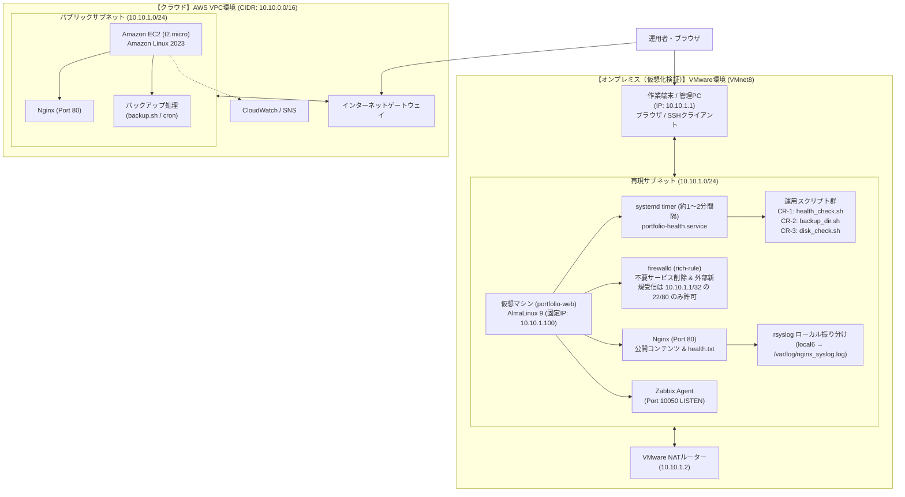
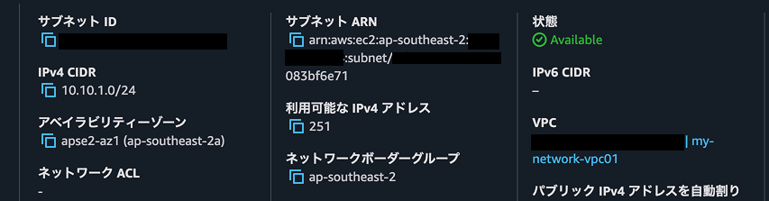
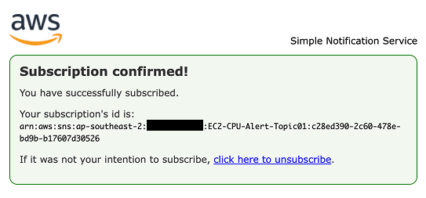
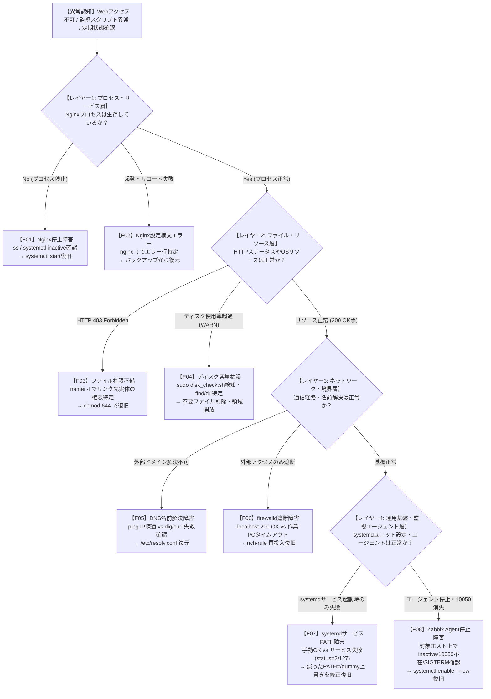

# 🚀 Webインフラ構築・運用保守 総合ポートフォリオ
## 〜 AWSクラウド環境の設計構築 ＆ ローカルLinux（AlmaLinux 9）での比較検証・障害対応レポート 〜

---

## 📌 エグゼクティブ・サマリ（1分でわかる全体像）

本ポートフォリオは、AWSクラウド環境におけるWebインフラの基本設計・構築と運用自動化、およびAWSの設計思想を参考にローカル仮想化環境（VMware / AlmaLinux 9）上で主要な通信・アクセス制御・運用監視を再現・比較検証した自主検証プロジェクトの全容をまとめた成果物です。

「手順通りに構築して終わり」ではなく、運用現場で即戦力として求められる3つの実務能力の実証に重きを置いています：

1. 根拠ある詳細パラメータ設計: 全23項目にわたる設定理由・確認コマンドの策定（[3.1 パラメータシート](docs/parameters.csv)）
2. 安全な変更管理による運用ツールの改修: タイムアウト、入力バリデーション、設定分離、バックアップ作成スクリプト化と別手順での復元diff照合を実施（[第4章 CR-1〜CR-3](docs/change_request.md)・[証跡T12](evidence/T12_cr2_backup_test.txt)）
3. 8大障害シナリオに対する論理的な一次切り分け: プロセス・ファイル権限・ネットワーク・systemdサービス環境設定に至る階層型トラブルシューティング（[第5章 F01〜F08](evidence/)・[証跡F07](evidence/F07_timer_env_diff.txt)）

### 📊 プロジェクト概要一覧

| 項目 | 内容 |
| :--- | :--- |
| 担当範囲 | 要件整理、パラメータ設計、クラウド環境構築、Linux環境再現、運用スクリプト改修、障害再現・一次切り分け実証、ドキュメント作成（全工程を自主検証として単独実施） |
| 技術スタック | クラウド: AWS (VPC, Subnet, IGW, RouteTable, EC2, IAM, SecurityGroup, CloudWatch Alarm, SNS)<br>OS/仮想化: Amazon Linux 2023, AlmaLinux 9.x, VMware Workstation<br>ミドルウェア: Nginx, systemd (Service / Timer), firewalld (rich-rule), chronyd, rsyslog, Zabbix Agent<br>スクリプト: Bash (引数バリデーション, 一行パース, エラーハンドリング) |
| 主要な実績 | ・AWSとLinuxローカル環境でのWeb基盤構築と機能対比<br>・systemd timerによる自律的Web死活監視（約1〜2分間隔）の実装<br>・運用スクリプト3本の堅牢化（CR-1: 本文判定・タイムアウト, CR-2: 保存先引数化・事前検証と別手順での復元diff照合 [[T12](evidence/T12_cr2_backup_test.txt)], CR-3: 設定外部化・閾値整合性検証 [[T13](evidence/T13_cr3_config_test.txt)]）<br>・現場頻発障害8パターン（F01〜F08、特に systemd サービスの誤った `PATH` 上書き障害 [[F07](evidence/F07_timer_env_diff.txt)]）の論理的切り分け・復旧実証 |
| 未検証・今後の課題 | ・CloudWatch AgentによるAWS側のカスタムメトリクス・ログ転送、およびCPU負荷投入によるALARM遷移・SNSメール受信の実証（現在はEC2標準メトリクスのアラーム設定・SNS購読Confirmed・正常時OK状態の確認まで実施）<br>・AWS環境におけるcron定刻実行の事後ログ検証（AWS側は初期スクリプトの手動実行とcrontab登録確認までとし、エラー処理・事前検証・復元diff照合はローカル環境CR-2にて実装・検証）<br>・SSM Session Managerによるブラウザ/CLI接続（現在はEC2へのIAMロール付与まで実施、接続は未検証）<br>・Zabbix Serverによる集中メトリクス収集・アラート連携（現在はAgent単体導入・対象ホスト上でのローカル取得まで検証）<br>・rsyslogによる別ホストへのリモートログ転送（現在は同一サーバー内での `/var/log/nginx_syslog.log` 振り分けまで検証）<br>・ローカル環境におけるアラート自動通知連携（T16はsyslog記録・終了コード1出力での検知確認までとし、通知は未実装）<br>・AWSとオンプレミスのVPN/DirectConnect閉域網接続、およびALB + マルチAZによる高可用性（HA）冗長化 |

---

## 📋 目次

- [1. 全体概要とプロジェクト目的](#1-全体概要とプロジェクト目的)
  - [1.1 プロジェクト概要](#11-プロジェクト概要)
  - [1.2 インフラ全体構成図（比較検証構成）](#12-インフラ全体構成図比較検証構成)
  - [1.3 クラウドとオンプレミスLinuxの機能対比表](#13-クラウドとオンプレミスlinuxの機能対比表)
  - [1.4 AWSクラウド環境の主要設計値](#14-awsクラウド環境の主要設計値)
  - [1.5 ローカル仮想化（AlmaLinux 9）での検証目的](#15-ローカル仮想化almalinux-9での検証目的)
- [2. AWSクラウド環境の設計・構築](#2-awsクラウド環境の設計構築)
  - [2.1 ネットワーク環境の新規構築（VPC / Subnet / IGW）](#21-ネットワーク環境の新規構築vpc--subnet--igw)
  - [2.2 Webサーバーの土台構築とセキュリティ設定（EC2 / IAMロール / SG）](#22-webサーバーの土台構築とセキュリティ設定ec2--iamロール--sg)
  - [2.3 SSH接続とWebサーバー（Nginx）の導入・疎通確認](#23-ssh接続とwebサーバーnginxの導入疎通確認)
  - [2.4 ネットワーク疎通・システムリソースの稼働状態確認](#24-ネットワーク疎通システムリソースの稼働状態確認)
  - [2.5 運用保守の自動化（シェルスクリプトによるバックアップ作成とcron登録確認）](#25-運用保守の自動化シェルスクリプトによるバックアップ作成とcron登録確認)
  - [2.6 Amazon CloudWatchによるリソース監視・アラーム通知設定](#26-amazon-cloudwatchによるリソース監視アラーム通知設定)
- [3. オンプレミス（VMware / AlmaLinux 9）環境の設計・構築・動作検証](#3-オンプレミスvmware--almalinux-9環境の設計構築動作検証)
  - [3.1 ネットワークおよび詳細パラメータ設計](#31-ネットワークおよび詳細パラメータ設計)
  - [3.2 Webサーバー構築とアクセス制御（Nginx / firewalld rich-rule）](#32-webサーバー構築とアクセス制御nginx--firewalld-rich-rule)
  - [3.3 運用保守・定期自動監視基盤（systemd service / timer）](#33-運用保守定期自動監視基盤systemd-service--timer)
  - [3.4 監視エージェントおよびローカルsyslog集約（Zabbix Agent / rsyslog）](#34-監視エージェントおよびローカルsyslog集約zabbix-agent--rsyslog)
  - [3.5 基本・統合動作試験結果（T01〜T16）](#35-基本統合動作試験結果t01t16)
- [4. 運用ツールの改修実績（Change Request: CR-1 〜 CR-3）](#4-運用ツールの改修実績change-request-cr-1--cr-3)
  - [4.1 変更管理（CR）の運用方針](#41-変更管理crの運用方針)
  - [4.2 CR-1: health_check.sh（タイムアウト・応答本文検証・終了コード厳密化）](#42-cr-1-health_checkshタイムアウト応答本文検証終了コード厳密化)
  - [4.3 CR-2: backup_dir.sh（保存先引数化・事前バリデーション）と別手順での復元diff照合](#43-cr-2-backup_dirsh保存先引数化事前バリデーションと別手順での復元diff照合)
  - [4.4 CR-3: disk_check.sh（設定ファイル分離・引数上書き・入力バリデーション）](#44-cr-3-disk_checksh設定ファイル分離引数上書き入力バリデーション)
- [5. 障害対応手順書（Runbook）：実務レベルの一次切り分け・復旧実証（F01 〜 F08）](#5-障害対応手順書runbook実務レベルの一次切り分け復旧実証f01--f08)
  - [5.1 障害対応アプローチと階層型切り分けフロー](#51-障害対応アプローチと階層型切り分けフロー)
  - [5.2 【F01】Nginxプロセス停止障害（Connection refused検知）](#52-f01nginxプロセス停止障害connection-refused検知)
  - [5.3 【F02】Nginx設定構文エラー（reload失敗）](#53-f02nginx設定構文エラーreload失敗)
  - [5.4 【F03】公開ファイル権限不備（HTTP 403 Forbidden）](#54-f03公開ファイル権限不備http-403-forbidden)
  - [5.5 【F04】ディスク容量枯渇障害（WARN検知・大容量ファイル特定）](#55-f04ディスク容量枯渇障害warn検知大容量ファイル特定)
  - [5.6 【F05】外部名前解決（DNS）障害（IP直打ち疎通 vs ドメイン解決不可）](#56-f05外部名前解決dns障害ip直打ち疎通-vs-ドメイン解決不可)
  - [5.7 【F06】firewalldによる外部通信遮断（localhost疎通 vs 外部タイムアウト）](#57-f06firewalldによる外部通信遮断localhost疎通-vs-外部タイムアウト)
  - [5.8 【F07】systemd サービス実行環境障害（誤ったPATH上書きによるコマンド未検出）](#58-f07systemd-サービス実行環境障害誤ったpath上書きによるコマンド未検出)
  - [5.9 【F08】監視エージェント（Zabbix Agent）停止と待受消失の確認・復旧](#59-f08監視エージェントzabbix-agent停止と待受消失の確認復旧)
  - [5.10 ツール非依存の手動切り分け（3区分）と障害報告フォーマット](#510-ツール非依存の手動切り分け3区分と障害報告フォーマット)
- [6. 総括とハイブリッド環境における習得スキル](#6-総括とハイブリッド環境における習得スキル)
  - [6.1 本プロジェクトの成果と設計意図](#61-本プロジェクトの成果と設計意図)
  - [6.2 証明される習得スキル](#62-証明される習得スキル)
  - [6.3 今後の展望](#63-今後の展望)

---

# 1. 全体概要とプロジェクト目的

## 1.1 プロジェクト概要
本プロジェクトでは、AWS上における仮想ネットワーク環境（VPC）の設計・構築から、EC2インスタンスによるWebサーバー（Nginx）の起動、保守自動化（バックアップスクリプト・cron定時実行）、およびAmazon CloudWatchによるシステム監視設定までを網羅した「AWSクラウドインフラ環境」を構築しました。

さらに、AWSのVPC設計思想とIPアドレス設計を参考に、独立したVMware NAT環境（AlmaLinux 9）で同等の目的を持つネットワーク・アクセス制御・監視構成を作成し、クラウドとオンプレミスLinux環境におけるインフラ構築・運用の比較検証を実施しました。

> [!NOTE]
> **本検証環境の構成範囲について**
> 本プロジェクトはAWSとオンプレミスをVPNやDirect Connectで直接接続したハイブリッド閉域網ではなく、それぞれ独立した検証環境です。AWSのVPC設計思想とIPアドレス設計（`10.10.1.0/24`）を参考に、独立したVMware NAT環境で同等の目的を持つネットワーク構成・アクセス制御・運用監視を作成し比較検証しています（なお、将来VPN等で両環境を相互接続する場合は、アドレス範囲の重複によるルーティング不整合を避けるため別セグメントへ分離する設計となります）。

特にオンプレミスLinux環境においては、以下の実務運用フェーズの全ライフサイクルを深く追究しています：
* 「詳細パラメータ設計」: なぜその設定値にするのかの根拠（設計理由）と確認結果の管理。
* 「通信・疎通確認」: レイヤーごとの内部・外部からの通信疎通検証。
* 「運用の自動化・改修」: 単にスクリプトを動かすだけでなく、異常系の例外処理やバリデーション、systemd timerによる定期監視、変更管理手順（Change Request）に則った改修。
* 「監視エージェント・ログ振り分け」: Zabbix Agentによるローカルメトリクス取得と、rsyslogによる同一サーバー内でのNginxアクセスログ振り分け（ローカルsyslog集約）。
* 「障害時の一次切り分け」: 頻発する8つのシステム障害に対する論理的な仮説検証・復旧実証（ランブック化）。

## 1.2 インフラ全体構成図（比較検証構成）

本プロジェクトで構築・検証したインフラの全体構成図です。AWS上のVPC環境と、VMware上の仮想化環境における設計的・技術的な対応関係を示しています。



## 1.3 クラウドとオンプレミスLinuxの機能対比表

AWSクラウド上の各インフラ構成要素と、オンプレミス（VMware）環境における技術的対応関係の一覧です。両環境の設計思想と差異を体系的に比較しています。

| 比較項目 | AWSクラウド環境 | オンプレミス（VMware）環境 | 技術的ポイント・設計意図 |
| :--- | :--- | :--- | :--- |
| 仮想化ホスト | AWSマネージドインフラ | VMware Workstation (ローカル) | クラウドプロバイダ管理とローカルハイパーバイザの違い |
| ゲストOS | Amazon Linux 2023 | AlmaLinux 9.x | RedHat系・dnfパッケージ管理の親和性を担保 |
| ホスト名 | EC2プライベートDNS名 | `portfolio-web` | 複数サーバー運用時の誤操作防止・ログ識別 |
| 仮想ネットワーク | VPC (Subnet: `10.10.1.0/24`) | VMware NATモード (Subnet: `10.10.1.0/24`) | AWSのVPC設計思想とIPアドレス設計を参考に、独立したVMware NAT環境で同等の目的を持つネットワーク構成を作成 |
| 外部通信経路 | インターネットゲートウェイ (IGW) | 仮想NATルーター (`10.10.1.2`) | 外部インターネット接続およびデフォルトゲートウェイルーティング |
| ファイアウォール | セキュリティグループ (SG) | `firewalld` (rich-rule設定) | ENI単位のステートフル仮想FW（SG）とLinuxホスト内部のパケットフィルタ（`firewalld`）の仕組みの違いを踏まえ、受信アクセス制御の目的で対比 |
| リモート管理 | SSH接続（SSM用IAMロール付与まで・接続は未検証） | SSH接続 (ポート22: 送信元IP制限) | 一般ユーザー（`user`）によるSSH運用と、設定ファイル保護（`600 root`）に伴う特権コマンドの `sudo` 分離 |
| Webサーバー | Nginx (HTTP Port 80) | Nginx (HTTP Port 80) | 同一ミドルウェアを用いた設定プロセスの検証およびヘルスチェック配置 |
| タスク自動実行 | `cron` 定時実行 | `systemd.timer` (`OnUnitActiveSec=1min`) | cronとsystemdタイマーのログ管理性（journald連携）やユニット環境変数設定の比較 |
| 運用保守ツール | 日付付き `tar` バックアップスクリプト | 改修版スクリプト群（CR-1〜CR-3） | AWS側の初期スクリプト（`backup.sh`）の課題をローカル側（CR-1〜CR-3）で改善（引数化、書き込み権限検証、外部設定分離、インジェクション対策） |
| 死活・リソース監視 | Amazon CloudWatch (標準メトリクス / Alarm / SNS) | Zabbix Agent (Port 10050) & スクリプト | クラウド統合監視とOSSエージェント導入・ローカルメトリクス取得の対比（Zabbix Serverは未構築） |
| ログ管理 | OSローカルログ出力（CWAgent連携は今後の課題） | `rsyslog` 同一サーバー内振り分け (`local6`) | OS標準syslog機構を用いた同一サーバー内でのアクセスログ分離記録（`/var/log/nginx_syslog.log`） |

## 1.4 AWSクラウド環境の主要設計値

| 項目 | 採用テクノロジー / 設計値 | 目的・特徴 |
| :--- | :--- | :--- |
| 仮想ネットワーク | VPC (`10.10.0.0/16`) / パブリックサブネット (`10.10.1.0/24`) | セキュアで論理的に分離されたNW空間の確保 |
| 仮想サーバー | Amazon EC2 (Amazon Linux 2023, t2.micro) | Webコンテンツを配信するWebサーバー基盤として利用 |
| Webサーバー | Nginx (HTTP Port 80) | 高パフォーマンスで軽量なリバースプロキシ・Webサーバー |
| アクセス管理 | SSH (Port 22: 送信元IP制限) ※SSM用IAMロール付与済み（接続は未検証） | 最小権限の原則に基づくリモート管理設計 |
| 保守自動化 | Shell Script (`tar` バックアップ) & `cron` 登録 | cron登録および手動実行によるバックアップ生成確認（定時実行は未検証） |
| リソース監視 | Amazon CloudWatch Alarm & Amazon SNS (Email) | CloudWatch AlarmとSNSを連携しCPU異常検知時にメール通知する構成を設定（SNSのConfirmed状態とAlarmのOK状態を確認、高負荷によるALARM遷移・メール受信実証は未実施） |

## 1.5 ローカル仮想化（AlmaLinux 9）での検証目的
AWS環境の専用OS「Amazon Linux 2023」の比較対象として、パッケージ構成やベースシステムが近い「AlmaLinux 9」を採用。AWSのVPC設計思想とIPアドレス設計を参考に、独立したVMware NAT環境で同等の目的を持つネットワーク構成を作成し、固定IPアドレスの割り当て、ホストPCからのSSH接続制限、OS内ファイアウォール制御、およびWebサーバー（Nginx）の導入を比較検証しました。

さらに、パラメータシートに基づく構成管理、systemd timerによる自律運用、Zabbix Agent等の監視エージェント導入、運用ツールの設計改修（Change Request）、そして8種類の障害に対する論理的な一次切り分けを実践・記録することで、現場で自走できるインフラエンジニアとしての実務適性を証明しています。

---

# 2. AWSクラウド環境の設計・構築

## 2.1 ネットワーク環境の新規構築（VPC / Subnet / IGW）
システム基盤となるパブリックサブネット含むVPC環境をAWS上に構築しました。

* 設計値：VPC: `my-network-vpc01` (`10.10.0.0/16`) / サブネット: `my-public-subnet01` (`10.10.1.0/24`)

#### ① VPC（仮想ネットワーク空間）の作成
将来の拡張性を考慮し、IPアドレス範囲 `10.10.0.0/16` にてVPCを新規作成。


#### ② パブリックサブネットの作成
仮想サーバーを配置するため、VPC内にCIDR範囲 `10.10.1.0/24` のパブリックサブネットを切り出し。


#### ③ インターネットゲートウェイ（IGW）の接続
VPC内部から外部インターネットと双方向通信を行うためのIGWを作成し、VPCにアタッチ。


#### ④ ルートテーブルの構成とサブネットの関連付け
ルートテーブルを新規作成し、デフォルトルート（`0.0.0.0/0`）の送信先としてIGWを指定。この設定をサブネットに関連付けることで、インターネット接続可能なパブリックサブネットとして有効化。


---

## 2.2 Webサーバーの土台構築とセキュリティ設定（EC2 / IAMロール / SG）
WebサーバーをホストするためのEC2インスタンスを起動し、アクセス制御および管理用の設定を適用しました。

#### ① SSH接続キーペアの作成
安全なリモート管理を実現するため、RSA暗号方式（`.pem`形式）のキーペア `my-network-key01` を作成。


#### ② セキュリティグループ（ファイアウォール）の設計とインバウンド制限
管理アクセス（SSH: 22番ポート）の送信元を自身の接続元IPアドレス（マイIP）に限定し、外部からの不正なSSH接続を遮断。Web公開確認用のHTTP（80番ポート）は `0.0.0.0/0` に設定。
※本構成（パブリックサブネットへの単一EC2配置およびHTTP 80番の全体公開）はインフラ基礎検証・疎通確認を目的とした学習用最小構成であり、本番環境で求められる構成（ALB + ACMによるHTTPS化、WAF、プライベートサブネット配置、マルチAZ冗長化）との違いは6.3節（今後の展望）にて整理しています。


#### ③ EC2インスタンスの作成とネットワークアタッチ
事前に定義したVPC・パブリックサブネットのネットワーク設定とセキュリティグループを適用し、Amazon Linux 2023（t2.micro）のEC2インスタンスを起動。


#### ④ セキュアリモート管理（SSMセッションマネージャー）のためのIAMロールの付与
SSH接続の送信元IP制限に加え、将来的に管理ポート（22番）を閉塞してブラウザやAWS CLI経由でリモート接続（SSMセッションマネージャー）できるよう、ポリシー `AmazonSSMManagedInstanceCore` を付与したIAMロールをEC2にアタッチ（本検証ではIAMロールの設計・付与までを実施し、SSM経由の実接続は今後の課題としています）。


#### ⑤ 仮想サーバー（EC2）の起動確認
設定が完了し、EC2インスタンスが正常に「実行中」ステータスになったことを確認。


---

## 2.3 SSH接続とWebサーバー（Nginx）の導入・疎通確認
作成したEC2インスタンスへ接続し、Webサーバーパッケージ（Nginx）の導入とWeb公開疎通の検証を行いました。
※スクリーンショットおよび本文中のパブリックIPアドレスはセキュリティ配慮により `<EC2_PUBLIC_IP>` としてマスクしています（検証完了に伴いインスタンスは停止・廃棄済み）。

#### ① SSH接続の実行
ダウンロードした秘密鍵ファイルのアクセスパーミッションを `chmod 400`（所有者のみ読み取り可能）へ厳格に変更し、EC2のパブリックIP経由でSSH接続を確立。
```bash
chmod 400 my-network-key01.pem
ssh -i my-network-key01.pem ec2-user@<EC2_PUBLIC_IP>
```


#### ② OSパッケージ更新およびNginxの導入
OSパッケージを最新化し、dnfパッケージマネージャーからNginxをインストール。
```bash
sudo dnf update -y
sudo dnf install nginx -y
```

#### ③ Webサーバープロセスの起動と自動起動設定
Webサーバープロセスを起動し、仮想サーバー再起動時にも自動的に立ち上がるよう自動起動（enable）を設定。
```bash
sudo systemctl start nginx
sudo systemctl enable nginx
```

#### ④ Nginxプロセスの稼働状態確認
サービス稼働ステータスを確認し、プロセスが `Active: active (running)` で正常常駐していること、および自動起動設定（`enabled`）が有効であることを確認。
```bash
sudo systemctl status nginx
```


#### ⑤ ブラウザからのHTTP疎通確認
クライアント端末のWebブラウザからEC2のパブリックIP（`http://<EC2_PUBLIC_IP>/`）へアクセスし、Nginxのデフォルトページが表示されることを確認。


---

## 2.4 ネットワーク疎通・システムリソースの稼働状態確認
初期構築完了後の安定運用フェーズ移行にあたり、ネットワークとハードウェアリソース（ストレージ・メモリ）の健全性チェックを行いました。

#### ① 外部ネットワークへの双方向疎通確認
サーバー内部から外部DNSサーバー（Google Public DNS）に対して `ping` を実行し、双方向の接続が正常に維持されていることを確認（パケット損失 0%）。
```bash
ping -c 4 8.8.8.8
```


#### ② ディスク容量・ストレージ空き状況の確認
ルートボリュームの使用状況を確認し、空き容量が十分に確保されていることを確認（使用率 21%）。
```bash
df -h
```


#### ③ 空きメモリ領域の確認
物理メモリの使用状況を測定し、動作を圧迫しない空き領域（available: 670MB）が存在することを確認。
```bash
free -m
```


---

## 2.5 運用保守の自動化（シェルスクリプトによるバックアップ作成とcron登録確認）
運用の信頼性を高め手動オペレーションを削減するため、Nginxの稼働確認・設定ディレクトリの圧縮バックアップスクリプトの作成と手動実行確認、およびcronへのスケジュール登録を行いました。

#### ① ディレクトリ構造の設計と権限管理の適正化
バックアップ専用フォルダ `/var/backup` を作成。初期作成時のroot所有権による一般ユーザー（`ec2-user`）の書込エラー（Permission denied）を解決するため、適切に所有権を `chown` で変更し、最小権限に即したセキュリティを確保。

#### ② 日付付与型バックアップスクリプト（`backup.sh`）の作成と実行権限付与
Nginxの設定ディレクトリ `/etc/nginx` を圧縮アーカイブ化し、ファイル名に実行日（`date +%Y%m%d`）を付与する初期版シェルスクリプトを作成。あわせて、作成したスクリプトに実行権限を付与し、Nginxの稼働状態を `/var/log/nginx_monitor.log` へ記録する監視スクリプト（`monitor.sh`）も整備。
※下記のコードはEC2上で実際に作成・手動実行した初期版スクリプト（直下の証跡画像 `img/backup_inside.png` と同一内容）です。この初期版では `tar` の終了コード判定を行わずに完了メッセージを表示する構造となっており、この課題をローカル環境の CR-2（4.3節 `backup_dir.sh`）にて終了コード判定付きへ改善しています。

```bash
#!/bin/bash
# バックアップを保存するフォルダ
BACKUP_DIR="/var/backup"
# 保存するファイル名（日付を入れる）
BACKUP_FILE="nginx_backup_$(date +%Y%m%d).tar.gz"

# バックアップを実行（Nginxの設定フォルダを固める）
tar -czf "$BACKUP_DIR/$BACKUP_FILE" /etc/nginx

echo "Backup completed: $BACKUP_FILE"
```

```bash
chmod +x backup.sh
```

#### ③ スクリプト自動実行（cronタスクスケジュール）の登録
crontabを編集し、システム負荷の低い深夜時間帯（毎日午前3:00）に完全自動でバックアップ処理を実行するよう設定。
```text
0 3 * * * /home/ec2-user/backup.sh
```

#### ④ 動作検証の範囲とローカル環境（CR-2）への改善発展
AWS環境では、稼働監視スクリプト（`monitor.sh`）による稼働ログ記録の確認、バックアップスクリプト（`backup.sh`）の手動実行による `/var/backup` 配下への日付付きアーカイブ（`nginx_backup_20260616.tar.gz`）生成、および `crontab -l` によるスケジュール登録までを確認しました（深夜03:00のcron定刻実行後の事後ログ検証は未実施）。
また、この初期版 `backup.sh` には「保存先が固定」「対象不在や書き込み権限の事前チェックがない」「`tar` の終了コードを判定せず失敗時も完了メッセージが出る」「同日複数回実行時に同名ファイルが上書きされる」「復元検証が含まれていない」という課題があったため、第4章のローカル環境改修（CR-2: `backup_dir.sh`）にて、秒単位タイムスタンプ・引数化・事前バリデーション・終了コード厳密化・復元後 `diff` 照合へと発展させています。


---

## 2.6 Amazon CloudWatchによるリソース監視・アラーム通知設定
CloudWatch AlarmとSNSを連携し、CPU使用率の異常検知時にメール通知する構成を設定しました。SNSサブスクリプションのConfirmed状態とCloudWatch AlarmのOK状態を確認しており、CPU高負荷によるALARM遷移およびメール受信の実証は未実施（今後の検証課題）としています。

#### ① CloudWatch アラーム閾値の定義
EC2インスタンスのCPU使用率（`CPUUtilization`）を監視対象とし、`Period: 300秒（5分）`・`EvaluationPeriods: 1` にて「5分間のメトリクス集計値が閾値80%を超えた場合に判定する」条件を指定（5分間の全瞬間で80%を超え続けるという意味ではなく、5分間の集計値に基づく1期間判定）。


#### ② Amazon SNSと連携した管理者通知アクションの設定
アラーム通知用のSNSトピック（`EC2-CPU-Alert-Topic01`）を作成し、アラーム遷移時に指定の管理者宛てに即座に通知メールを配信するアクションを定義。


#### ③ 通知サブスクリプションの購読アクティベート
送信された確認メール（Subscription Confirmation）から認証URLへアクセスし、購読ステータスを承認（Confirmed）状態に移行。


#### ④ リソース監視機能の稼働状態確認
初期設定が完了し、現在のメトリクスが正常値（閾値未満）を維持していることを表す「OK」ステータスへの遷移を確認。


---

# 3. オンプレミス（VMware / AlmaLinux 9）環境の設計・構築・動作検証

## 3.1 ネットワークおよび詳細パラメータ設計
実務のシステム構築では「なんとなく設定する」のではなく、「なぜその値にするのか（設計理由）」を明確にし、設定後に想定通りの状態になっているかをコマンドで客観的に確認することが不可欠です。本プロジェクトでは、全23項目の詳細パラメータシート（[docs/parameters.csv](docs/parameters.csv)）を策定して構築を実施しました。

| 設定項目 | 設定値 | 設定理由（設計思想） | 確認コマンド | 確認結果 |
| :--- | :--- | :--- | :--- | :--- |
| ホスト名 | `portfolio-web` | 複数サーバー運用時の誤操作防止および各種システムログでの識別のため | `hostnamectl` | Static hostname: portfolio-web |
| IPv4アドレス | `10.10.1.100/24` | Webサーバーとして管理端末から恒常的に同一アドレスで疎通・運用するため | `ip -br addr` | ens160 に 10.10.1.100/24 が UP |
| デフォルトゲートウェイ | `10.10.1.2` | VMware NAT仮想ルーターを経由して外部ネットワークおよびインターネットと通信するため | `ip route` | default via 10.10.1.2 dev ens160 が登録 |
| DNSサーバー | `10.10.1.2 8.8.8.8` | パッケージ導入（dnf）や名前解決を安全に行うため | `cat /etc/resolv.conf` | nameserver 10.10.1.2 と 8.8.8.8 が設定 |
| IPv4設定方式 | `manual` | DHCPによる意図しないIP変更を防ぎ静的IP運用を担保するため | `nmcli -f ipv4.method connection show ens160` | ipv4.method: manual |
| タイムゾーン | `Asia/Tokyo` | アクセスログ・障害ログの記録時刻を日本標準時（JST）に統一しログ照合を容易にするため | `timedatectl` | Time zone: Asia/Tokyo (JST +0900) |
| 時刻同期（NTP） | `chronyd 有効` | 監視サーバーや作業端末との時刻乖離による障害解析・ログ順序の誤認を防ぐため | `chronyc tracking` | Leap status: Normal / Reference ID 同期確認 |
| firewalld (不要サービス削除) | `services: なし（cockpit / dhcpv6-client 削除）` | デフォルト開放サービス（Cockpit: 9090/TCP等）を閉塞し許可通信を10.10.1.1/32の22/80のみに厳格化するため | `sudo firewall-cmd --list-all` | 削除適用後にservices空欄・恒久設定でNOT_ENABLED・9090番待受なしを確認（[firewalld_baseline.txt](evidence/firewalld_baseline.txt)） |
| firewalld (SSH) | `rich-rule: rule family="ipv4" source address="10.10.1.1/32" port port="22" protocol="tcp" accept` | 管理用SSHを作業PC（VMnet8）からのアクセスのみに限定するため | `sudo firewall-cmd --list-all / 作業PCからのSSH試行` | 10.10.1.1 から接続成功、別IPや許可前はタイムアウトを確認 |
| firewalld (HTTP) | `rich-rule: rule family="ipv4" source address="10.10.1.1/32" port port="80" protocol="tcp" accept` | Web表示・ヘルスチェック確認を作業PCからのみに限定するため | `sudo firewall-cmd --list-all / 作業PCからのHTTP試行` | ブラウザおよびcurlで200 OK確認（[firewalld_baseline.txt](evidence/firewalld_baseline.txt)） |
| nginx サービス | `enabled（自動起動有効化）` | サーバー再起動や障害復旧時に手動介入なしでWebサービスを復旧させるため | `systemctl is-enabled nginx / sudo reboot 後の疎通確認` | 再起動後も自動で active (running) になり応答を確認（T05） |
| ヘルスチェック | `/usr/share/nginx/html/portfolio/health.txt (644権限)` | 運用スクリプトや監視Agentが死活判定を行うための固定レスポンスを確保するため | `curl -i http://127.0.0.1/portfolio/health.txt` | HTTP/1.1 200 OK、本文 portfolio-ok を確認（T03） |
| portfolio-health.service | `ExecStart=/usr/bin/bash /home/user/portfolio-lab/scripts/health_check.sh http://127.0.0.1/portfolio/health.txt portfolio-ok` | CR-1改修に伴いURLに加え期待本文文字列（portfolio-ok）を引数として渡すため | `systemctl status portfolio-health.service` | code=exited, status=0/SUCCESS でスクリプトが正常終了することを確認 |
| portfolio-health.timer | `OnBootSec=2min / OnUnitActiveSec=1min` | OnBootSec=2minによりOS起動から2分後に初回実行し、以降はOnUnitActiveSec=1minにより前回のサービス起動から約1分後を基準に定期実行するため | `systemctl list-timers --all \| grep portfolio` | 実測のタイマー表示としてNEXT/LASTが約1〜2分間隔で更新されることを確認 |
| backup_dir.sh (CR-2) | `引数指定（$1:対象 $2:保存先）` | 保存先を実行時に指定可能にし、実行ユーザーの権限に基づく事前検証で対象不在や書込不可時の異常終了（コード2）を担保するため（特権対象はsudo実行、権限不足試験は一般ユーザー実行で確認） | `sudo ./scripts/backup_dir.sh /etc/nginx /home/user/portfolio-lab/backups/nginx` | 正常終了（コード0）および一般ユーザー実行での書込権限不足・対象不在時の異常検知（コード2）を確認 |
| disk_check設定ファイル | `/etc/ops/disk_check.conf` | スクリプト本体のハードコードを排除し環境差分を吸収するため | `sudo ls -l /etc/ops/disk_check.conf` | `-rw-------. 1 root root 86 10月 27 15:40 /etc/ops/disk_check.conf` |
| disk_check.conf権限 | `600 (root:root / sudo実行前提)` | 設定値改ざんや一般ユーザーによる不正閲覧を防止するため（`disk_check.sh` は `sudo` で実行） | `sudo stat -c "%a" /etc/ops/disk_check.conf` | `600` |
| Zabbixエージェントポート | `10050/TCP` | Zabbix Server未構築のため、現段階では対象ホスト上でのAgent起動・ローカルメトリクス取得を検証対象とする（外部Serverからのポーリングおよびアクティブチェックは未検証） | `ss -tlpn \| grep 10050` | `LISTEN 0 4096 0.0.0.0:10050 0.0.0.0:*` |
| Zabbixエージェント設定 | `Server=127.0.0.1 / ServerActive=127.0.0.1 / Hostname=portfolio-web` | 設定ファイルにServer=127.0.0.1およびServerActive=127.0.0.1を明示してローカル検証に限定しHostname=portfolio-webを指定するため | `grep -E "^(Server\|ServerActive\|Hostname)=" /etc/zabbix/zabbix_agentd.conf` | `Server=127.0.0.1, ServerActive=127.0.0.1, Hostname=portfolio-web` |
| rsyslog転送設定 | `/etc/rsyslog.d/50-nginx-forward.conf` | Webアクセスログを同一サーバー内のsyslog基盤（`/var/log/nginx_syslog.log`）へローカル集約・分離記録するため | `sudo ls -l /etc/rsyslog.d/50-nginx-forward.conf` | `-rw-r--r--. 1 root root 345 10月 26 16:37 /etc/rsyslog.d/50-nginx-forward.conf` |
| nginx syslog出力 | `facility=local6,tag=nginx,severity=info` | アクセスログを通常のファイル保存と並行してローカルsyslog（local6）へ連携するため | `sudo nginx -T \| grep syslog` | `access_log syslog:server=127.0.0.1...` |
| portfolio-health 実行環境PATH | `Environment="PATH=/usr/local/sbin:/usr/local/bin:/usr/sbin:/usr/bin"` | systemdの既定PATH（`/usr/bin`等を含む）を明示し誤ったPATH上書きによるコマンド未検出（コード127）を防ぐため | `systemctl cat portfolio-health.service` | PATH定義確認 |
| Zabbix Agent サービス | `enabled (自動起動有効化)` | OS再起動時にもエージェント停止を発生させないため | `systemctl is-enabled zabbix-agent` | enabled確認 |

---

## 3.2 Webサーバー構築とアクセス制御（Nginx / firewalld rich-rule）

### ① Nginxの導入とコンテンツ配置
AlmaLinux 9上でNginxを導入し、サービスの常駐化と自動起動を有効化しました。また、死活監視用のエンドポイントとして `/usr/share/nginx/html/portfolio/health.txt` を配置し、パーミッション `644`（所有者: root）で固定テキスト `portfolio-ok` を出力するように設定しました。

```bash
# パッケージの導入と起動
sudo dnf install nginx -y
sudo systemctl enable --now nginx

# ヘルスチェック用エンドポイントの作成
sudo mkdir -p /usr/share/nginx/html/portfolio
echo "portfolio-ok" | sudo tee /usr/share/nginx/html/portfolio/health.txt
sudo chmod 644 /usr/share/nginx/html/portfolio/health.txt
```

### ② firewalld の不要サービス削除と rich-rule による送信元IP限定制御
AWS環境のセキュリティグループ（送信元IP制限）の設計思想をOS内部で再現するため、`firewalld` のデフォルトゾーン（`public`）で初期有効化されている不要サービス（`cockpit`（9090/TCP）および `dhcpv6-client`）を削除した上で、作業端末（`10.10.1.1/32`）からの SSH（22/TCP）と HTTP（80/TCP）のみを許可する rich-rule（リッチルール）を投入しました（証跡: [evidence/firewalld_baseline.txt](evidence/firewalld_baseline.txt) ※記録前に削除を適用済みであり、証跡では削除後の `--list-all` で `services:` が空欄であること、および `--remove-service` 再実行時の `NOT_ENABLED` により恒久設定からも除去済みであることを確認しています）。

```bash
# デフォルト開放サービス（cockpit / dhcpv6-client）を削除し全送信元開放ポートを閉塞
sudo firewall-cmd --permanent --zone=public --remove-service=cockpit
sudo firewall-cmd --permanent --zone=public --remove-service=dhcpv6-client

# 作業端末 (10.10.1.1/32) からの SSH (22) および HTTP (80) のみ許可
sudo firewall-cmd --permanent --zone=public --add-rich-rule='rule family="ipv4" source address="10.10.1.1/32" port port="22" protocol="tcp" accept'
sudo firewall-cmd --permanent --zone=public --add-rich-rule='rule family="ipv4" source address="10.10.1.1/32" port port="80" protocol="tcp" accept'
sudo firewall-cmd --reload
```
これにより、`sudo firewall-cmd --list-all` 上で `services:` および `ports:` が空欄（`cockpit.socket` も `inactive` で9090番待受なし）となり、外部からの新規受信通信について、作業端末 `10.10.1.1/32` からのSSH（22/TCP）およびHTTP（80/TCP）のみを許可する構成（送信通信や既存の確立済み通信まで一律に遮断するものではない）を実現しています。

---

## 3.3 運用保守・定期自動監視基盤（systemd service / timer）
AWSではcronとCloudWatchを使用しましたが、オンプレミス（Linux標準）の実務構成として、より堅牢でjournaldとの統合ログ管理が可能な systemd service & timer による自律監視基盤を構築しました。

* サービス定義ファイル（[systemd/portfolio-health.service](systemd/portfolio-health.service)）:
```ini
[Unit]
Description=Portfolio local HTTP check
Wants=network-online.target
After=network-online.target nginx.service

[Service]
Type=oneshot
User=user
WorkingDirectory=/home/user/portfolio-lab
Environment="PATH=/usr/local/sbin:/usr/local/bin:/usr/sbin:/usr/bin"
ExecStart=/usr/bin/bash /home/user/portfolio-lab/scripts/health_check.sh http://127.0.0.1/portfolio/health.txt portfolio-ok
StandardOutput=journal
StandardError=journal
```

* タイマー定義ファイル（[systemd/portfolio-health.timer](systemd/portfolio-health.timer)）:
```ini
[Unit]
Description=Run portfolio HTTP check (about 1-2 min interval)

[Timer]
OnBootSec=2min
OnUnitActiveSec=1min
Unit=portfolio-health.service

[Install]
WantedBy=timers.target
```
このタイマーを有効化することで、`OnBootSec=2min` によりOS起動から2分後に初回実行し、以降は `OnUnitActiveSec=1min` により前回のサービス起動から約1分後を基準に定期実行します（実際のタイマー表示やジャーナルログの観測結果では約1〜2分間隔で推移）。Web停止時にはsystemd journalへ即座に異常ステータスが記録されます（[evidence/T10_timer_repeat.txt](evidence/T10_timer_repeat.txt)）。

---

## 3.4 監視エージェントおよびローカルsyslog集約（Zabbix Agent / rsyslog）

### ① Zabbix Agent によるローカルメトリクス取得検証
エンタープライズ環境で標準的に採用される統合監視ソフトウェア「Zabbix」の監視エージェント（Zabbix Agent）を導入しました。
※Zabbix Server未構築のため、現段階では対象ホスト上でのAgent起動・ローカルメトリクス取得を検証対象とし、外部Serverからのポーリングおよびアクティブチェック（ならびに `firewalld` での 10050/TCP 外部開放）は未検証としています。
- 設定ファイル（抜粋）: [config/zabbix_agentd.conf](config/zabbix_agentd.conf)（`/etc/zabbix/zabbix_agentd.conf` にて `Server=127.0.0.1`、`ServerActive=127.0.0.1`、`Hostname=portfolio-web` を明示的に設定）
- 待受ポート: 対象ホスト上で Agent の `10050/TCP` が LISTEN していることを確認。
- 動作検証: 対象ホスト上で `zabbix_agentd -t system.cpu.load[all,avg1]` および `vfs.fs.size[/,free]` を実行し、CPU負荷（ロードアベレージ）やディスク空き容量のローカルメトリクス取得が正常に動作することを実証（[evidence/T14_zabbix_agent.txt](evidence/T14_zabbix_agent.txt)）。

### ② Nginx アクセスログの同一サーバー内 rsyslog 振り分け（ローカルsyslog集約）
Nginxのアクセスログを通常のファイル出力（`/var/log/nginx/access.log`）に加え、同一サーバー内のsyslog機構（`local6` ファシリティ）へリアルタイム連携して別ファイルへ振り分ける構成を検証しました。
- Nginx設定ファイル: [config/nginx.conf](config/nginx.conf)（23行目: `access_log syslog:server=127.0.0.1,facility=local6,tag=nginx,severity=info main;`）
- rsyslog設定ファイル: [config/50-nginx-forward.conf](config/50-nginx-forward.conf)（`/etc/rsyslog.d/50-nginx-forward.conf` にて `local6.* /var/log/nginx_syslog.log` を定義。別ホストへのUDP転送構文 `@192.168.1.100:514` はコメントとして保持）
- 動作検証: Webアクセスに伴い、同一サーバー内の `/var/log/nginx_syslog.log` へリアルタイムにsyslogヘッダー付きアクセスログが記録されることを確認（[evidence/T15_rsyslog_forward.txt](evidence/T15_rsyslog_forward.txt)）。

---

## 3.5 基本・統合動作試験結果（T01〜T16）
構築したオンプレミス環境の健全性を客観的に証明するため、全16項目（19行）のテストケースを策定し、現行版スクリプトを用いて正常系・異常系・統合動作の検証を実施しました。すべての試験で想定通りの結果を確認しています（[docs/test_results.csv](docs/test_results.csv)）。

| No | 確認項目 | 期待する結果 | 実際の結果 | 判定 | 証跡エビデンス |
| :---: | :--- | :--- | :--- | :---: | :--- |
| T01 | 作業PCからSSH接続できる | ログインできホスト名がportfolio-web | 接続成功、ホスト名確認 | 合格 | [evidence/T01_ssh_login.png](evidence/T01_ssh_login.png) |
| T02 | 時刻同期が有効 | chronyd同期、TZがAsia/Tokyo | System clock synchronized: yes 確認 | 合格 | [evidence/T02_ntp_sync.png](evidence/T02_ntp_sync.png) |
| T03 | 内部HTTP応答 | HTTP 200、本文 `portfolio-ok` | `200 OK, portfolio-ok` | 合格 | [evidence/T03_internal_http.txt](evidence/T03_internal_http.txt) |
| T04 | 外部HTTP応答 | 作業PCブラウザ/curlから同一応答 | `200 OK, portfolio-ok` | 合格 | [evidence/T04_browser_access.png](evidence/T04_browser_access.png) |
| T05 | 再起動後の自動起動 | reboot後もNginx自動起動、応答維持 | active、uptime直後、200 OK | 合格 | [evidence/T05_reboot_check.txt](evidence/T05_reboot_check.txt) |
| T06-1 | Web監視 正常系 | `health_check.sh`（現行版）の終了コード 0 | HTTP 200・本文一致で終了コード 0 を確認 | 合格 | [evidence/T06_health_ok.txt](evidence/T06_health_ok.txt) |
| T06-2 | Web監視 HTTP異常 | HTTP 404等の異常時に終了コード 1 | 404指定で終了コード 1 を確認 | 合格 | [evidence/T06_health_404.txt](evidence/T06_health_404.txt) |
| T06-3 | Web監視 接続失敗 | 接続拒否・タイムアウトで終了コード 2 | 未使用ポート1番指定（curlコード7）で終了コード 2 確認 | 合格 | [evidence/T06_health_connfail.txt](evidence/T06_health_connfail.txt) |
| T07-1 | ディスク監視 正常 | `sudo ./scripts/disk_check.sh` の終了コード 0 | 設定ファイル閾値80%で終了コード 0 を確認 | 合格 | [evidence/T07_diskok.txt](evidence/T07_diskok.txt) |
| T07-2 | ディスク監視 警告 | 閾値超過時に終了コード 1 | `sudo` 実行・引数閾値1%指定で終了コード 1 を確認 | 合格 | [evidence/T07_disk_warn.txt](evidence/T07_disk_warn.txt) |
| T07-3 | ディスク監視 失敗 | 対象不在・閾値不正で終了コード 2 | `sudo` 実行・存在しないパス指定で終了コード 2 確認 | 合格 | [evidence/T07_disk_fail.txt](evidence/T07_disk_fail.txt) |
| T08 / T09 | バックアップ作成と復元照合 | 引数2つでバックアップ作成後、別フォルダへ展開し `diff` 一致 | 設定とhtmlを展開し `diff --no-dereference` で一致（SAME・コード0） | 合格 | [evidence/T08_backup_exec.txt](evidence/T08_backup_exec.txt) [evidence/T09_backup_exec.txt](evidence/T09_backup_exec.txt) |
| T10 | Web監視 定期実行 | タイマーにより定期実行＆停止ログ記録 | 約1〜2分間隔実行、停止時status=2記録 | 合格 | [evidence/T10_timer_repeat.txt](evidence/T10_timer_repeat.txt) |
| T11 | CR-1 改修試験 | 5パターン(0/1/1/2/2)が正しく返る | 全5パターン想定通りの終了コード確認 | 合格 | [evidence/T11_cr1_test.txt](evidence/T11_cr1_test.txt) |
| T12 | CR-2 改修試験 | 保存先引数化・事前検証（作成不可/書込不可）・別手順での復元diff照合 | 全6パターン（`mkdir` 失敗と `-w` 権限不足の双方を含む）想定通り確認 | 合格 | [evidence/T12_cr2_backup_test.txt](evidence/T12_cr2_backup_test.txt) |
| T13 | CR-3 改修試験 | 設定分離・引数上書き・入力検証（文字列/WARN>=CRIT/権限） | 全8パターン想定通りの終了コード(0/1/2)確認 | 合格 | [evidence/T13_cr3_config_test.txt](evidence/T13_cr3_config_test.txt) |
| T14 | Zabbix Agent ローカル取得 | 対象ホスト上でactive、10050 LISTEN、`zabbix_agentd -t` で値取得 | 10050 LISTEN、CPU/diskローカル取得確認 | 合格 | [evidence/T14_zabbix_agent.txt](evidence/T14_zabbix_agent.txt) |
| T15 | ローカルsyslog集約 | HTTPアクセス時に `/var/log/nginx_syslog.log` へ記録 | syslogヘッダー付き200ログのローカル集約を確認 | 合格 | [evidence/T15_rsyslog_forward.txt](evidence/T15_rsyslog_forward.txt) |
| T16 | 異常ログ・終了コード確認 | 404ログ記録・ディスク超過WARNログとコード1出力（通知は未実装） | syslog404記録・`sudo` 実行でWARNログと終了コード1を確認 | 合格 | [evidence/T16_alarm_detect.txt](evidence/T16_alarm_detect.txt) |

---

# 4. 運用ツールの改修実績（Change Request: CR-1 〜 CR-3）

## 4.1 変更管理（CR）の運用方針
実務の運用保守現場では、運用中のスクリプトや設定変更を行う際、「変更要求」「変更前の課題」「影響範囲」「正常系/異常系の検証」「切り戻し（Rollback）手順」を台帳化して安全に適用する変更管理プロセスが求められます。
本プロジェクトでは、[docs/change_request.md](docs/change_request.md) に基づき、3つの運用ツールの改修（CR-1 〜 CR-3）を実施・検証しました。
また、改修前のオリジナルスクリプトを [scripts.orig/](scripts.orig/) に保持し、改修後の全スクリプト（`scripts/*.sh`）に対して `bash -n` による構文チェックを実施してエラーがないことを確認しています（また `backup_dir.sh` の `mkdir -p` 判定は `$?` の間接参照ではなく `if ! mkdir -p` による直接判定へ改善済みです）。

---

## 4.2 CR-1: health_check.sh（タイムアウト・応答本文検証・終了コード厳密化）

* 対象ファイル: [scripts/health_check.sh](scripts/health_check.sh)（改修前: [scripts.orig/health_check.sh](scripts.orig/health_check.sh) / 差分全文: [evidence/CR1.diff](evidence/CR1.diff)）
* 課題と変更理由:
  - 【課題】タイムアウト未指定のため、サーバーハング時にプロセスが無限に滞留し、systemd timer の次回実行をブロックするリスクがあった。また、HTTP 200 が返ればWebサーバーのエラー画面（メンテナンス画面等）でも正常判定されていた。
  - 【解決】`--connect-timeout 3`（接続3秒）および `--max-time 5`（全体5秒）を追加。さらにレスポンス本文に期待する文字列（`portfolio-ok`）が含まれているかを `grep -qF`（固定文字列検索）で検証するロジックを実装。
  - 【終了コードの厳密化】
    - `0`: 正常（HTTP 200 かつ 本文一致）
    - `1`: 異常検知（HTTP 4xx/5xx、または本文不一致）
    - `2`: 判定不能・通信失敗（引数不正、接続拒否、タイムアウト）

* 主な変更箇所の抜粋（全文は [evidence/CR1.diff](evidence/CR1.diff) を参照）:
```diff
--- scripts.orig/health_check.sh
+++ scripts/health_check.sh
+# 2. curl 実行（タイムアウト指定 + 本文とステータスコードを同時取得）
+TEMP_RESPONSE=$(mktemp)
+HTTP_STATUS=$(curl -s -S \
+    --connect-timeout 3 \
+    --max-time 5 \
+    -o "$TEMP_RESPONSE" \
+    -w "%{http_code}" \
+    "$URL" 2>/dev/null)
+CURL_EXIT=$?
+
+# 3. 一次判定: curl 自体の実行成否（ネットワーク・名前解決・タイムアウト）
+if [ $CURL_EXIT -ne 0 ]; then
+    echo "[FAIL] 通信失敗: 接続拒否またはタイムアウト (curl終了コード: $CURL_EXIT)" >&2
+    rm -f "$TEMP_RESPONSE"
+    exit 2
+fi
+
+# 4. 二次判定: HTTP ステータスコードの確認
+if [ "$HTTP_STATUS" != "200" ]; then
+    echo "[WARN] 異常検知: HTTP ステータスコード $HTTP_STATUS" >&2
+    rm -f "$TEMP_RESPONSE"
+    exit 1
+fi
+
+# 5. 三次判定: 期待する本文文字列が含まれているか
+if ! grep -qF "$EXPECTED_BODY" "$TEMP_RESPONSE"; then
+    echo "[WARN] 異常検知: HTTP 200 ですが期待文字列 '$EXPECTED_BODY' が本文に含まれません" >&2
+    rm -f "$TEMP_RESPONSE"
+    exit 1
+fi
```

* 検証結果（5パターン完全検証）（[evidence/T11_cr1_test.txt](evidence/T11_cr1_test.txt)）:
  1. 正常アクセス（200 + 一致）: `Exit Code 0`
  2. 本文不一致（200 + 文字列違い）: `Exit Code 1`
  3. HTTP 404 Not Found: `Exit Code 1`
  4. ポート未開放（Connection refused）: `Exit Code 2`
  5. 無応答IPへの接続（3秒でタイムアウト）: `Exit Code 2`
* 切り戻し手順: `cp -a scripts.orig/health_check.sh scripts/health_check.sh`（または `patch -R -p0 < evidence/CR1.diff`）

---

## 4.3 CR-2: backup_dir.sh（保存先引数化・事前バリデーション）と別手順での復元diff照合

* 対象ファイル: [scripts/backup_dir.sh](scripts/backup_dir.sh)（改修前: [scripts.orig/backup_dir.sh](scripts.orig/backup_dir.sh) / 差分全文: [evidence/CR2.diff](evidence/CR2.diff)）
* 課題と変更理由:
  - 【課題】バックアップ保存先が固定されており、対象不在や保存先ディレクトリの作成失敗・書き込み権限不足の際に、`tar` 実行前に処理を中断する事前チェックがなかった。
  - 【解決】第1引数に対象ディレクトリ、第2引数に保存先ディレクトリを指定可能に変更。`tar` 実行前に「対象の存在確認」「保存先ディレクトリの作成成否判定（`if ! mkdir -p`）」「保存先への書き込み権限確認（`[ ! -w "$DEST_DIR" ]`）」を行う事前バリデーションを実装し、不備がある場合は `tar` を起動せず終了コード 2 で安全に中断する。また、絶対パスではなく相対パス（`-C` オプション）で `tar.gz` 圧縮を行い展開時の上書き事故を防止。
  - 【実行ユーザーと権限チェックの前提（重要）】
    - スクリプト内の `[ ! -w "$DEST_DIR" ]` は**実行ユーザーの権限**に基づいて書き込み可否を判定する（root実行時は通常の権限ビットによらず書き込み可能と判定される）。そのため、以下の通り実行方式を区分している：
      1. **一般ユーザーでバックアップする場合**：一般ユーザーで読み取り可能な対象と書き込み可能な保存先を指定する。
      2. **root権限でバックアップする場合**：`/etc/nginx` 等の特権ディレクトリを対象とする場合は `sudo` を使用し、rootとして書き込み可能な保存先を指定する。
      3. **書き込み権限不足の試験（T12パターン4）**：一般ユーザー（`sudo` なし）で実行し、root所有 `755` の `/srv/backup_ro` に対して終了コード 2 で中断することを確認する。
  - 【実装範囲と今後の改善課題】
    - スクリプト本体の実装範囲は事前バリデーションと `tar.gz` アーカイブ作成（および `tar` 終了コード判定）までとし、展開（復元）および `diff -r` 照合は別手順の検証として実施。
    - なお、3引数以上渡された場合の余剰引数エラー判定（`[ "$#" -ne 2 ]`）、および `tar` 圧縮途中の異常中断時に作成途中の不完全ファイルを自動削除する仕組み（一時ファイル `.tmp` 作成後の `mv` や `trap` による削除）は今後の拡張課題としている。

* AWS側の初期スクリプト（`backup.sh`）からの改善対比:

| 比較項目 | AWS側初期実装（2.5節 `backup.sh`） | ローカル側改修版（CR-2 `backup_dir.sh`） |
| :--- | :--- | :--- |
| バックアップ対象 | `/etc/nginx` に固定 | 第1引数で任意ディレクトリを指定可能 |
| 保存先ディレクトリ | `/var/backup` に固定 | 第2引数で任意の保存先を指定可能 |
| ファイル名（世代管理） | 日付のみ（`%Y%m%d`：同日再実行で上書き） | 秒単位タイムスタンプ（`%Y%m%d_%H%M%S`） |
| 実行前の事前検証 | なし | 引数・対象存在・保存先作成成否・書込権限（`-w`）を検証 |
| エラー処理・終了コード | `tar` 成否判定なし | 正常（`0`）・圧縮失敗（`1`）・事前検証失敗（`2`）に厳密分類 |
| 復元・整合性確認 | 未実施（アーカイブ生成確認まで） | 別ディレクトリ展開後の `diff -r` 一致確認・改変検知を実施 |

* 主な変更箇所の抜粋（全文は [evidence/CR2.diff](evidence/CR2.diff) を参照）:
```diff
--- scripts.orig/backup_dir.sh
+++ scripts/backup_dir.sh
+# 2. 対象ディレクトリの存在確認
+if [ ! -d "$TARGET_DIR" ]; then
+    echo "[FAIL] 対象ディレクトリが存在しません: $TARGET_DIR" >&2
+    exit 2
+fi
+
+# 3. 保存先ディレクトリの作成と書込権限チェック
+if [ ! -d "$DEST_DIR" ]; then
+    if ! mkdir -p "$DEST_DIR" 2>/dev/null; then
+        echo "[FAIL] 保存先ディレクトリを作成できません: $DEST_DIR" >&2
+        exit 2
+    fi
+fi
+
+# 保存先への書き込み権限テスト
+if [ ! -w "$DEST_DIR" ]; then
+    echo "[FAIL] 保存先ディレクトリへの書き込み権限がありません: $DEST_DIR" >&2
+    exit 2
+fi
+
+# 4. アーカイブ作成
+tar -czf "$DEST_FILE" -C "$(dirname "$TARGET_DIR")" "$TARGET_BASE" 2>/dev/null
```

* 検証結果（全6パターン：事前検証と別手順での復元差分照合）（[evidence/T12_cr2_backup_test.txt](evidence/T12_cr2_backup_test.txt)）:
  1. 正常系: `/etc/nginx` と保存先を指定しアーカイブ生成成功（`Exit Code: 0`）。
  2. 異常系（対象不在）: 存在しないパス `/not_exist_dir` 指定時に中断（`Exit Code: 2`）。
  3. 異常系（保存先作成不可）: `/proc/invalid_backup` 指定時に `mkdir -p` 失敗分岐で中断（`Exit Code: 2`）。
  4. 異常系（書き込み権限なし）: root所有 `755` の既存ディレクトリ `/srv/backup_ro` に対し一般ユーザー `user` で実行し、`[ ! -w ]` 分岐（「書き込み権限がありません」）で中断（`Exit Code: 2`）。
  5. 復元検証（別手順）: `/tmp/restore_t12` に展開後、`diff -r --no-dereference` で元データとの完全一致（`Exit Code: 0`）を確認。
  6. 改変検知（別手順）: 復元ファイルを意図的に改変後、`diff -r --no-dereference` が差分を検知（`Exit Code: 1`）。
* 切り戻し手順: `cp -a scripts.orig/backup_dir.sh scripts/backup_dir.sh`（または `patch -R -p0 < evidence/CR2.diff`）

---

## 4.4 CR-3: disk_check.sh（設定ファイル分離・引数上書き・入力バリデーション）

* 対象ファイル: [scripts/disk_check.sh](scripts/disk_check.sh)（改修前: [scripts.orig/disk_check.sh](scripts.orig/disk_check.sh) / 差分全文: [evidence/CR3.diff](evidence/CR3.diff)）
* 設定ファイル: [config/disk.conf](config/disk.conf)（配置先: `/etc/ops/disk_check.conf`, パーミッション `600 root:root`）
* 課題と変更理由:
  - 【課題】監視対象マウントポイントや警告閾値がスクリプト内にハードコードされており、環境ごとの閾値変更のたびにスクリプト本体を修正する運用リスクがあった。また、`source` や `.` による外部ファイル読み込みは悪意あるコードの任意実行（コマンドインジェクション）につながる危険があった。
  - 【解決】設定ファイル `/etc/ops/disk_check.conf` へ外部化（`TARGET_MOUNT=/`, `WARN_THRESHOLD=80`, `CRIT_THRESHOLD=90`）し、パーミッションを `600`（root所有）に制限。このため、`disk_check.sh` は `sudo`（root権限）で実行する運用に統一し、一般ユーザーが `sudo` なしで実行した場合は読み取り権限チェック（`[ ! -r "$CONF_FILE" ]`）で明確にエラー終了（終了コード 2）させる。
  - 設定値の読み込みは `while IFS='=' read -r key value` でキーと値を1行ずつ安全に解析し、設定ファイル側・引数側の双方に対して整数チェック、範囲チェック（1〜100）、および警告閾値と重大閾値の大小関係チェック（`WARN < CRIT` を満たさない場合は終了コード 2）を実装。
  - 【位置引数による一時上書き仕様】
    - 第1引数（`$1`）：監視対象マウントポイント（省略時は設定ファイルの `TARGET_MOUNT`）
    - 第2引数（`$2`）：WARN閾値（省略時は設定ファイルの `WARN_THRESHOLD`）
    - 第3引数（`$3`）：CRIT閾値（省略時は設定ファイルの `CRIT_THRESHOLD`）
    - ※T13では設定ファイル読み込みおよび `$1`・`$2` の上書き（ならびに `$2 >= CRIT` の検知）を試験しており、`$3` によるCRIT閾値の個別上書き試験は今後の拡張項目としている。

* 主な変更箇所の抜粋（全文は [evidence/CR3.diff](evidence/CR3.diff) を参照）:
```diff
--- scripts.orig/disk_check.sh
+++ scripts/disk_check.sh
+# 【バリデーション1-2】設定ファイルを読めるか（600 root のため sudo 実行が前提）
+if [ ! -r "$CONF_FILE" ]; then
+    echo "[UNKNOWN] Config file not readable: $CONF_FILE (run with sudo)" >&2
+    exit 2
+fi
+
+# 【安全な読み込み】余計なコマンド実行を許さず、KEY=VALUE形式のみ取り込む
+while IFS='=' read -r key value; do
+    [[ "$key" =~ ^[[:space:]]*# ]] && continue
+    [[ -z "$key" ]] && continue
+    case "$key" in
+        TARGET_MOUNT)   TARGET_MOUNT="$value" ;;
+        WARN_THRESHOLD) WARN_THRESHOLD="$value" ;;
+        CRIT_THRESHOLD) CRIT_THRESHOLD="$value" ;;
+    esac
+done < "$CONF_FILE"
+
+# 【バリデーション3】閾値が正の整数値になっているか
+if ! [[ "$WARN_THRESHOLD" =~ ^[0-9]+$ ]] || ! [[ "$CRIT_THRESHOLD" =~ ^[0-9]+$ ]]; then
+    echo "[UNKNOWN] Thresholds must be integers." >&2
+    exit 2
+fi
+
+# 警告閾値は重大閾値より小さくなければならない（設定ファイル・引数どちらの指定でも検査）
+if (( threshold >= crit_threshold )); then
+    echo 'UNKNOWN reason=warn_not_less_than_crit' >&2
+    exit 2
+fi
```

* 検証結果（全8パターン検証）（[evidence/T13_cr3_config_test.txt](evidence/T13_cr3_config_test.txt)）:
  1. Test1（設定ファイル正常読み込み）: `sudo ./scripts/disk_check.sh` で閾値80%判定（`Exit Code: 0`）。
  2. Test2（引数による閾値上書き）: `sudo ./scripts/disk_check.sh / 1` で警告検知（`Exit Code: 1`）。
  3. Test3（設定ファイル不在）: `/etc/ops/disk_check.conf` 不在時に `Config file not found` で中断（`Exit Code: 2`）。
  4. Test4（引数の閾値に文字列指定）: `sudo ./scripts/disk_check.sh / abc` で `invalid_threshold` 中断（`Exit Code: 2`）。
  5. Test5（設定ファイルの閾値に文字列指定）: `WARN_THRESHOLD=abc` 設定時に `Thresholds must be integers.` で中断（`Exit Code: 2`）。
  6. Test6（引数で `WARN >= CRIT` 指定）: `sudo ./scripts/disk_check.sh / 95`（CRIT=90）で `warn_not_less_than_crit` 中断（`Exit Code: 2`）。
  7. Test7（設定ファイルで `WARN >= CRIT` 指定）: `WARN_THRESHOLD=95`（CRIT=90）設定時に `warn_not_less_than_crit` 中断（`Exit Code: 2`）。
  8. Test8（`sudo` なし実行）: 一般ユーザー `user` で `./scripts/disk_check.sh` を実行し、`Config file not readable` で中断（`Exit Code: 2`）。
* 切り戻し手順: `cp -a scripts.orig/disk_check.sh scripts/disk_check.sh`（または `patch -R -p0 < evidence/CR3.diff`）

---

# 5. 障害対応手順書（Runbook）：実務レベルの一次切り分け・復旧実証（F01 〜 F08）

実務においてインフラ運用保守エンジニアに最も求められるのは、「アラートや不具合が発生した際に、当てずっぽうで再起動するのではなく、インフラのレイヤーに沿って論理的に原因を特定し、安全に復旧させる能力」です。

本プロジェクトでは、Webシステムで頻発する8つの障害シナリオ（F01〜F08）を意図的に再現し、障害投入から事実の収集、仮説検証、復旧、事後確認までを一貫して実証しました。

## 5.1 障害対応アプローチと階層型切り分けフロー



---

## 5.2 【F01】Nginxプロセス停止障害（Connection refused検知）
* 事象・検知:
  - Webアクセスを試みた際、即座に接続拒否（`Connection refused`）となり、`health_check.sh` が終了コード 2（通信失敗: curl終了コード 7）を出力（[evidence/F01_nginx_stop.txt](evidence/F01_nginx_stop.txt)）。
* 調査・事実収集（仮説検証）:
  - `ss -tlpn | grep 80` を実行 → 80番ポートでの待受プロセスが存在しない（出力なし）。
  - `systemctl status nginx` を実行 → `Active: inactive (dead)` となっており、プロセス自体が停止している事実を確認。
* 原因: Nginxサービスプロセスの停止。
* 復旧手順と確認:
  - `sudo systemctl start nginx` でプロセスを起動。
  - `ss -tlpn | grep :80` で LISTEN を確認し、`health_check.sh` にて終了コード 0（正常）への復帰を確認。

---

## 5.3 【F02】Nginx設定構文エラー（reload失敗）
* 障害投入:
  - 正常稼働時のバックアップ（`/etc/nginx/nginx.conf.bak`）が存在する状態で、`/etc/nginx/nginx.conf` の末尾に不正なディレクティブを追記して構文を破壊（[evidence/F02_nginx_syntax_err.txt](evidence/F02_nginx_syntax_err.txt)）：
    ```bash
    echo 'invalid_syntax_error_test;' | sudo tee -a /etc/nginx/nginx.conf
    ```
* 事象・検知:
  - 設定変更後の反映コマンド `sudo systemctl reload nginx` が失敗（`Job for nginx.service failed.` / `Exit Code: 1`）。
* 調査・事実収集（仮説検証）:
  - `sudo journalctl -u nginx -n 5 --no-pager` を確認 → `Reload failed` を記録（※1行目の `08:33:28` は直前の事前試行時のものであり、本試行の `08:38:35` で85行目のエラーを記録）。
  - 構文テストコマンド `sudo nginx -t` を実行 → `/etc/nginx/nginx.conf:85` において `nginx: [emerg] unknown directive "invalid_syntax_error_test" in /etc/nginx/nginx.conf:85` が発生している行番号と原因を特定。
* 原因: 設定ファイル編集時のオペレーションミスによる未知のディレクティブ混入（シンタックスエラー）。
* 復旧手順と確認:
  - 退避してあった正常なバックアップファイル（`/etc/nginx/nginx.conf.bak`）から復元：`sudo cp -a /etc/nginx/nginx.conf.bak /etc/nginx/nginx.conf`
  - `sudo nginx -t` を再実行し、`syntax is ok` および `test is successful`（`Exit Code: 0`）を確認。
  - `sudo systemctl reload nginx` を実行し、`./scripts/health_check.sh http://127.0.0.1/portfolio/health.txt portfolio-ok` にて正常稼働（`Exit Code: 0`）を確認。

---

## 5.4 【F03】公開ファイル権限不備（HTTP 403 Forbidden）
* 前提構造と障害投入:
  - AlmaLinux 9 のデフォルトトップページ `/usr/share/nginx/html/index.html` は、`../../testpage/index.html`（実体 `/usr/share/testpage/index.html`）への**シンボリックリンク**となっている。
  - `sudo chmod 600 /usr/share/nginx/html/index.html` を実行し、リンク先の実体ファイル `/usr/share/testpage/index.html` の権限を `600`（rootのみ読み取り可）へ変更（[evidence/F03_permission_403.txt](evidence/F03_permission_403.txt)）。
* 事象・検知:
  - 作業PC（Windows: `10.10.1.1`）から `PS C:\> curl.exe -I http://10.10.1.100/` を実行すると `HTTP/1.1 403 Forbidden` が返却。
  - サーバー内部（`10.10.1.100`）で `$ ./scripts/health_check.sh http://10.10.1.100/ Test` を実行しても、終了コード 1（HTTP 403 異常検知）を出力。
* 調査・事実収集（仮説検証）:
  - `sudo tail -n 2 /var/log/nginx/error.log` を確認 → 作業PCからのHEADリクエスト（`client: 10.10.1.1`）とサーバー内部からのGETリクエスト（`client: 10.10.1.100`）の双方で `open() "/usr/share/nginx/html/index.html" failed (13: Permission denied)` を記録。
  - シンボリックリンクを含むパス全体のパーミッション階層を可視化する `namei -l /usr/share/nginx/html/index.html` を実行。
  - 親ディレクトリ群は `drwxr-xr-x`（755）、シンボリックリンク自体は `lrwxrwxrwx` で正常だが、リンク先実体 `testpage/index.html` の権限が `-rw-------`（600: root所有）となっており、Webワーカープロセス（`nginx` ユーザー）からの読み取り権限が失われている事実を特定。
* 原因: シンボリックリンク先である公開実体ファイルのアクセス権限設定ミス（一般読み取り権限不足）。
* 復旧手順と確認:
  - `sudo chmod 644 /usr/share/nginx/html/index.html` によりリンク先実体へ一般読み取り権限（644）を付与。
  - サーバー内部での `./scripts/health_check.sh http://10.10.1.100/ Test`（`Exit Code: 0`）および作業PCからの `PS C:\> curl.exe -I http://10.10.1.100/` にて `HTTP/1.1 200 OK` への復帰を確認。

---

## 5.5 【F04】ディスク容量枯渇障害（WARN検知・大容量ファイル特定）
* 障害投入:
  - `sudo fallocate -l 8.5G /tmp/dummy_disk_fill.dat` を実行し、ルートファイルシステム（17GB）の使用率を `37%` から `87%` へ増加させる（[evidence/F04_disk_full.txt](evidence/F04_disk_full.txt)）。
* 事象・検知:
  - `sudo ./scripts/disk_check.sh` を実行すると、警告ログ `WARN target=/ used=87% threshold=80%` を出力し、終了コード 1 を返却。
* 調査・事実収集（仮説検証）:
  - `df -h /` で使用状況を確認 → ルートファイルシステム（`/`）の使用率が `87%` に急増。
  - 大容量ファイルの探索コマンドを実行：
    ```bash
    sudo find / -xdev -type f -size +1G -exec ls -lh {} + 2>/dev/null
    ```
    `/tmp/dummy_disk_fill.dat`（8.5GB）の存在を特定。
  - ディレクトリ階層ごとの消費量を `sudo du -xhd 1 / 2>/dev/null | sort -h -r | head -5` で裏付け（`/tmp` が 8.6GB を占有）。
* 原因: `/tmp` 直下における巨大ダミーファイル生成によるルートディスクの逼迫。
* 復旧手順と確認:
  - `sudo rm -f /tmp/dummy_disk_fill.dat` により不要ファイルを削除。
  - `df -h /` にて使用率が `37%` まで低減したことを確認。
  - `sudo ./scripts/disk_check.sh` を再実行し、`OK target=/ used=37% threshold=80%` および終了コード 0（正常）を確認。

---

## 5.6 【F05】外部名前解決（DNS）障害（IP直打ち疎通 vs ドメイン解決不可）
* 障害投入:
  - 正常な `/etc/resolv.conf` を退避した上で、到達不能なテスト用IPアドレス（`192.0.2.1`）へ書き換え（[evidence/F05_dns_failure.txt](evidence/F05_dns_failure.txt)）：
    ```bash
    sudo cp -a /etc/resolv.conf /root/resolv.conf.bak
    echo 'nameserver 192.0.2.1' | sudo tee /etc/resolv.conf
    ```
* 事象・検知:
  - `curl -sS -o /dev/null -w "%{http_code}\n" --max-time 5 https://www.google.com` を実行すると、`curl: (28) Resolving timed out after 5000 milliseconds`（`Exit Code: 28`）となり外部ドメインへの通信が失敗。
* 調査・事実収集（仮説検証）:
  - `ping -c 2 8.8.8.8` を実行 → パケット損失0%（`Exit Code: 0`）。`8.8.8.8` へのICMP疎通が成立しているため、少なくとも外部IPアドレスへの通信経路は確保されていることを確認。
  - `dig +time=2 +tries=1 www.google.com` を実行 → `connection timed out; no servers could be reached`（`Exit Code: 9`）を確認。DNS名前解決のみが失敗していることから、DNS設定に原因があると判断した。
* 原因: `/etc/resolv.conf` における未到達DNSサーバー（`192.0.2.1`）の設定による名前解決タイムアウト。
* 復旧手順と確認:
  - 退避していた設定ファイルから復元：`sudo cp -a /root/resolv.conf.bak /etc/resolv.conf`（`nameserver 10.10.1.2` / `8.8.8.8` の復帰を確認）。
  - `curl -sS -o /dev/null -w "%{http_code}\n" --max-time 5 https://www.google.com` を再実行し、ステータスコード `200`（`Exit Code: 0`）を確認。

---

## 5.7 【F06】firewalldによる外部通信遮断（localhost疎通 vs 外部タイムアウト）
* 障害投入:
  - 作業PC（`10.10.1.1/32`）からのHTTP（80/TCP）を許可している rich-rule を削除して反映（[evidence/F06_firewalld_block.txt](evidence/F06_firewalld_block.txt)）：
    ```bash
    sudo firewall-cmd --permanent --zone=public --remove-rich-rule='rule family="ipv4" source address="10.10.1.1/32" port port="80" protocol="tcp" accept'
    sudo firewall-cmd --reload
    ```
* 事象・検知:
  - 作業PC（Windows）から `PS C:\> curl.exe -I --connect-timeout 3 --max-time 5 http://10.10.1.100/` を実行すると、`curl: (28) Connection timed out after 3012 milliseconds` で接続タイムアウトが発生。
* 調査・事実収集（仮説検証）:
  - サーバー内部でローカル疎通を確認：`$ curl -sS -o /dev/null -w "%{http_code}\n" http://127.0.0.1/` → `200`（`Exit Code: 0`）が正常に応答。
  - 「NginxプロセスおよびOS内部のWeb機能は健全であり、外部とサーバー間のパケットフィルタ（firewalld）に原因がある」と切り分け。
  - `$ sudo firewall-cmd --list-all` を実行 → `services:` と `ports:` は空欄であり、`rich rules:` に22番ポート（SSH）の許可のみが残り、80番ポート（HTTP）の許可ルールが消失している事実を確認。
* 原因: ファイアウォールのHTTP許可 rich-rule 欠落による外部HTTPパケットの遮断。
* 復旧手順と確認:
  - 作業PC許可ルールを再投入：
    ```bash
    sudo firewall-cmd --permanent --zone=public --add-rich-rule='rule family="ipv4" source address="10.10.1.1/32" port port="80" protocol="tcp" accept'
    sudo firewall-cmd --reload
    ```
  - `sudo firewall-cmd --list-all` で80番と22番の rich-rule が揃ったことを確認した上で、作業PCから `PS C:\> curl.exe -I --connect-timeout 3 --max-time 5 http://10.10.1.100/` を再実行し、`HTTP/1.1 200 OK` で疎通が回復することを確認。

---

## 5.8 【F07】systemd サービス実行環境障害（誤ったPATH上書きによるコマンド未検出）
* 前提知識と障害投入:
  - AlmaLinux 9（systemd）のサービス実行環境には、既定で `/usr/local/sbin:/usr/local/bin:/usr/sbin:/usr/bin` の `PATH` が含まれている。しかし、ユニット定義ファイル側で `Environment="PATH=..."` を誤って上書きすると、標準コマンド（`/usr/bin/mktemp`, `/usr/bin/curl`, `/usr/bin/rm` 等）が探索できなくなる。
  - 本シナリオでは、手動実行で正常（`Exit Code: 0`）を確認した後、ユニット定義の `PATH` を意図的に `/dummy` へ書き換え、`daemon-reload` の上で `systemctl restart portfolio-health.service` によりサービスを手動起動して障害を再現した（[evidence/F07_timer_env_diff.txt](evidence/F07_timer_env_diff.txt)）：
    ```bash
    sudo sed -i 's|Environment="PATH=.*"|Environment="PATH=/dummy"|' /etc/systemd/system/portfolio-health.service
    sudo systemctl daemon-reload
    sudo systemctl restart portfolio-health.service
    ```
* 事象・検知:
  - 対話シェルでの手動実行（`/home/user/portfolio-lab/scripts/health_check.sh ...`）は `Exit Code: 0` で成功する一方、`systemctl restart portfolio-health.service` によるサービス起動では `Active: failed (Result: exit-code)`（`status=2/INVALIDARGUMENT`）で失敗。
* 調査・事実収集（仮説検証）:
  - `systemctl status portfolio-health.service` および `journalctl -u portfolio-health.service` を確認：
    - `bash[16259]: /home/user/portfolio-lab/scripts/health_check.sh: 行 24: mktemp: コマンドが見つかりません`
    - `bash[16258]: [FAIL] 通信失敗: 接続拒否またはタイムアウト (curl終了コード: 127)`
    - `bash[16262]: /home/user/portfolio-lab/scripts/health_check.sh: 行 36: rm: コマンドが見つかりません`
  - **終了コードの技術的根拠**:
    - `curl` 実行時に `PATH=/dummy` のため `/usr/bin/curl` が見つからず、Bashがコマンド未検出を表す終了コード **`127`** を返却。
    - `health_check.sh` は `[ $CURL_EXIT -ne 0 ]` の場合に `exit 2` する実装であるため、スクリプト全体の終了コードは **`2`** となる。
    - systemd は LSB の終了コード慣例に基づき、終了コード `2` に `status=2/INVALIDARGUMENT` というラベルを付記して表示する（スクリプトの引数が不正だったという意味ではない）。
* 原因: `portfolio-health.service` における誤った `Environment="PATH=/dummy"` 上書き設定。
* 復旧手順と確認:
  - ユニット定義の `PATH` を標準パスへ修正し、`daemon-reload` 後に `systemctl restart` でサービスを再実行して復旧を確認：
    ```bash
    sudo sed -i 's|Environment="PATH=/dummy"|Environment="PATH=/usr/local/sbin:/usr/local/bin:/usr/sbin:/usr/bin"|' /etc/systemd/system/portfolio-health.service
    sudo systemctl daemon-reload
    sudo systemctl restart portfolio-health.service
    ```
  - 直後の `systemctl status portfolio-health.service` にて、ログに `[OK] 正常稼働: HTTP 200 かつ 本文に 'portfolio-ok' を確認` が記録され、`code=exited, status=0/SUCCESS` で正常終了したことを確認。

---

## 5.9 【F08】監視エージェント（Zabbix Agent）停止と待受消失の確認・復旧
* 障害投入:
  - `sudo systemctl disable --now zabbix-agent` を実行し、エージェントの停止と自動起動設定の無効化を投入（[evidence/F08_zabbix_stopped.txt](evidence/F08_zabbix_stopped.txt)）。
* 事象・検知:
  - ※本環境では Zabbix Server は未構築のため、**対象ホスト上での手動の定期状態確認（`systemctl status zabbix-agent` および `ss -tlpn | grep 10050`）** を契機として、エージェント停止と待受ポート消失を発見。
* 調査・事実収集（仮説検証）:
  - 対象ホスト上で `systemctl status zabbix-agent` を確認 → `Active: inactive (dead)` かつ `disabled`（自動起動無効）を確認。
  - ポート待受確認を実行 → `Port 10050 is not listening.`（`ss` による10050番待受チェックの判定出力）となり、10050/TCP の LISTEN が消失している事実を確認。
  - `/var/log/zabbix/zabbix_agentd.log` を確認 → `Got signal [signal:15(SIGTERM),...]. Exiting ...`（SIGTERMによる正常停止ログ）が残されており、異常クラッシュではなく停止操作が行われた事実を特定。
  - ※なお、同ログ内の `Unable to connect to [127.0.0.1]:10051 ... Connection refused` は、`ServerActive=127.0.0.1` が設定ファイルに明示されており、接続先のZabbix Serverが未構築のため 10051/TCP への接続が拒否されることによる記録である。これはエージェント停止による異常ではなく、統合監視サーバー未構築に伴う想定された状態である。
* 原因: 監視エージェントプロセスの停止および自動起動設定（enable）の解除。
* 復旧手順と確認:
  - 即時起動および自動起動有効化：`sudo systemctl enable --now zabbix-agent`
  - `systemctl status zabbix-agent` で `active (running)` かつ `enabled` への復帰を確認し、`ss -tlpn | grep 10050` でポート 10050 の LISTEN 回復を確認。

---

## 5.10 ツール非依存の手動切り分け（3区分）と障害報告フォーマット
実務の障害一次対応においては、監視スクリプトや監視エージェント自体が異常を起こしているケース（誤検知や停止）も考慮し、自動化ツールに頼らずOS標準コマンドのみで手動切り分けを行う手順、および上位エスカレーション時の標準報告フォーマット（[docs/incident_template.md](docs/incident_template.md)）を定義しています。

### ① ツール非依存の手動切り分け（3つの責任区分）
異常認知時、以下の3区分で原因の所在を迅速に切り分けます：

| 区分 | 切り分け対象 | 手動確認コマンド（ツール非依存） | 判定基準 |
| :--- | :--- | :--- | :--- |
| 1. サービス自体 | Webサーバー（Nginx）・OSリソース・NW境界 | `systemctl status nginx`<br>`ss -tlpn \| grep :80`<br>`curl -i http://127.0.0.1/portfolio/health.txt`<br>`sudo firewall-cmd --list-all`<br>`df -h /` | ローカル `curl` やプロセス状態が異常であれば、監視ツールの問題ではなくWebサービスまたはOS自体の実障害と判定（F01〜F06）。 |
| 2. 運用ツール自体 | 監視・保守スクリプトのロジックや設定ファイル | `bash -n scripts/health_check.sh`<br>`sudo cat /etc/ops/disk_check.conf`<br>`./scripts/health_check.sh http://127.0.0.1/portfolio/health.txt portfolio-ok`<br>`sudo ./scripts/disk_check.sh` | サービス自体が正常（`curl` で200 OK）なのにスクリプト手動実行がエラーとなる場合、スクリプトの引数指定・設定ファイル（CR-3等）または `sudo` 実行漏れと判定。 |
| 3. 実行環境 | systemd service / timer、環境変数、実行ユーザー権限 | `systemctl status portfolio-health.service`<br>`journalctl -u portfolio-health.service -n 20`<br>`systemctl cat portfolio-health.service`<br>`namei -l /usr/share/nginx/html/index.html` | 対話シェルでのスクリプト手動実行は成功（コード0）するのに、systemdサービスとしての実行時のみ失敗する場合は、ユニット定義での誤った `PATH` 上書きや `User=` 権限差異と判定（F07）。 |

### ② 一次切り分けの報告フォーマット（事実と推測の分離）
上位エンジニアへのエスカレーションや顧客報告を行う際は、思い込みによる誤誘導を防ぐため、[docs/incident_template.md](docs/incident_template.md) に基づき「確認した事実」「未確認事項・仮説」「次の調査・対応アクション」を明確に分離して報告します：

* 確認した事実（Fact）:
  - 発生時刻（タイムゾーン付き）、実行したコマンド、出力されたエラーメッセージ・終了コード、および取得した証跡ファイル（`evidence/F*.txt`）のみを客観的に記載。
* 仮説と未確認事項（Hypothesis & Unverified）:
  - 事実から導かれる原因の推測と、現時点でまだ確認できていない範囲（否定できた仮説も含む）を明記。
* 次の調査・対応（Next Action）:
  - 復旧に向けて実施する具体的なコマンド（設定変更やサービス再起動）、影響範囲、切り戻し方法、および次回報告予定時刻を提示。

---

# 6. 総括とハイブリッド環境における習得スキル

## 6.1 本プロジェクトの成果と設計意図
本プロジェクトでは、AWS上でのセキュアなクラウド基盤構築にとどまらず、オンプレミス（仮想化）環境における「詳細パラメータ設計」「運用保守ツールの自律改修」「8大障害シナリオに対する実証的なトラブルシューティング」までを一貫して完遂しました。

特に以下の設計・運用アプローチは、現場での実務を強く意識したものとなっています：
1. セキュリティと最小権限・実行権限の明確な分離:
   - AWSでのセキュリティグループ（マイIP制限）とSSM用IAMロール設計、オンプレミスでの `firewalld` 不要サービス（`cockpit` 等）削除と rich-rule による `10.10.1.1/32` 限定通信。
   - 権限要件に応じた実行ユーザーの使い分け：HTTP死活監視（`health_check.sh` / `portfolio-health.service`）は非特権の一般ユーザー（`user`）で実行する一方、設定ファイル `/etc/ops/disk_check.conf` を `600 root:root` で保護した `disk_check.sh` は `sudo`（root権限）で実行する設計とし、一般ユーザーが誤って `sudo` なしで `disk_check.sh` を実行した際は読み取り不可（終了コード 2）として検知。また、`backup_dir.sh` は対象に応じた実行方式（特権ディレクトリ `/etc/nginx` 対象時は `sudo` 実行、一般ユーザー運用時および書き込み権限不足試験時は一般ユーザー実行）を明確に定義。
2. 安全な変更管理（Change Request）プロセスの実践:
   - スクリプト改修時における「事前バリデーション（`mkdir` 失敗と実行ユーザー権限に基づく `-w` 書込不可の分離、設定ファイル・引数双方の型・大小関係 `WARN < CRIT` 検証）」「タイムアウト考慮」「終了コード厳密化」「別手順での復元後diff差分照合」「`scripts.orig/` と `CR*.diff` によるロールバック手順の担保」。
3. 論理的な障害切り分けアプローチ:
   - 当てずっぽうな再起動ではなく、OS・ネットワーク・ファイル権限（シンボリックリンク実体）・ミドルウェア・systemdユニット環境変数に至る各レイヤーで事実（コマンド結果・終了コード）を収集し、仮説を立てて検証するランブックの確立。

## 6.2 証明される習得スキル

* クラウド（AWS）インフラ設計・構築力
  - VPC/サブネット/IGW/ルートテーブルによるネットワーク空間設計、EC2構築、IAMロール設計、CloudWatch AlarmとSNSを連携した監視通知設定（Confirmed状態およびAlarmのOK状態確認）。
* オンプレミス（Linux/仮想化）詳細構成管理力
  - VMware NATネットワーク設計、AlmaLinux 9の静的IP・ゲートウェイ・DNS制御、`firewalld` による不要サービス閉塞と外部新規受信通信の rich-rule アクセス制御、時刻同期（chrony）管理。
* 運用保守自動化およびスクリプト開発・改修力（Bash）
  - コマンドインジェクション対策（1行パース）、入力値・閾値大小関係バリデーション、タイムアウト設定、異常終了コードの設計、systemd service & timer による定期自動監視の構築。
* 監視エージェントおよびローカルsyslog集約の構築力
  - Amazon CloudWatch（標準メトリクス / Alarm / SNS連携設定）、Zabbix Agent（対象ホスト上での10050待受とローカルメトリクス取得）、rsyslog（`local6` ファシリティ連携）を用いた同一サーバー内でのアクセスログ分離記録の構築。
* 現場標準の障害一次切り分け・トラブルシューティング力
  - プロセス停止、設定構文エラー、シンボリックリンク実体の権限不備（403/namei）、ディスク枯渇（du/find）、DNS解決不備（ping vs dig/curl）、ファイアウォール遮断、systemdユニットのPATH上書き障害（コード127→2）、エージェント停止など、現場で直面する多角的なトラブルに対する論理的解決力。

## 6.3 今後の展望
今後は、構築したシングルサーバー環境から発展させ、実務における高可用性・耐障害性・セキュリティをさらに向上させるための以下の取り組みを検討します。

- クラウド監視・管理の拡張: CloudWatch Agent 導入によるメモリ・ディスク等のカスタムメトリクス監視および CloudWatch Logs へのWebログ集約、ならびに SSM Session Manager を用いたSSHポートレス運用の実接続検証。
- 統合監視・リモートログ転送の拡張: 別ホストへの Zabbix Server 構築によるエージェント死活・メトリクス統合監視と自動アラート通知、および rsyslog リモート転送による専用ログサーバーへの集約。
- Infrastructure as Code (IaC) の導入: Ansible によるオンプレミスAlmaLinuxのパラメータ自動プロビジョニング、および Terraform によるAWSリソースのコード管理。
- 高可用性（HA）化とCI/CD: ALB（Application Load Balancer）とマルチAZ構成による冗長化、および GitHub Actions を用いた運用スクリプトの自動テスト（ShellCheck）パイプラインの構築。
